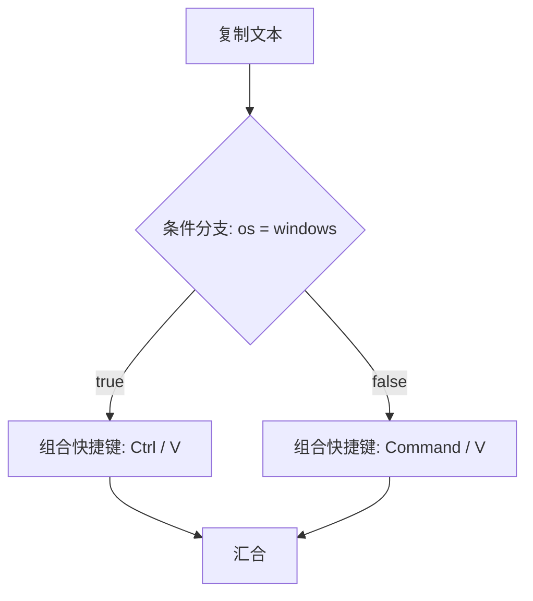

# LaunchFlow 详细使用手册

适用版本：**v0.4.27**。编写日期：**2026-10-15**。

本手册按照当前版本的界面、33 种步骤定义、12 种触发器定义，以及 Windows / macOS 实际执行代码编写。中英文名称与软件中的标签对应；代码名称用于辨认导出文件中的配置。未在界面提供独立输入框的高级字段会明确标出。

重点配置快捷入口：[Highlight 的作用](#highlight) · [Accessibility 配置](#accessibility) · [Absolute Coordinate 配置](#absolute-coordinate) · [Fallback 的配置和执行顺序](#fallback)。

## 目录

1. [安装、升级与平台区别](#installation)
2. [软件结构与基本概念](#concepts)
3. [第一次使用：创建一个可运行的场景](#quick-start)
4. [应用库：每个配置项](#applications)
5. [我的场景与工作流编辑器](#editor)
6. [所有步骤的通用配置、搜索与变量](#common)
7. [定位器与 Fallback 的工作规则](#locator-rules)
8. [七种定位器：用途、字段和示例](#locators)
9. [Pick Element、Highlight、Test Action 与激活窗口](#tools)
10. [全部 20 种 GUI 步骤](#gui-actions)
11. [应用、文件、等待、复制文本与命令步骤](#basic-actions)
12. [条件分支、汇合与子流程](#flow)
13. [场景设置与参数](#scene-settings)
14. [全部 12 种触发器](#triggers)
15. [录制、暂停、审阅与插入步骤](#recording)
16. [工作区捕获、布局恢复与关闭应用](#workspace)
17. [权限与凭据](#permissions)
18. [软件设置、登录启动与自动登录](#settings)
19. [运行历史、诊断、暂停与失败恢复](#runs)
20. [导入、导出、备份与跨平台迁移](#transfer)
21. [完整配置示例](#recipes)
22. [常见问题与排查顺序](#troubleshooting)
23. [配置索引与实现依据](#reference)

<a id="installation"></a>

## 1. 安装、升级与平台区别

### 1.1 选择安装包

下载页面：[LaunchFlow v0.4.27](https://github.com/LiguoXia/LaunchFlow/releases/tag/v0.4.27)。

| 系统                | 下载文件                                            | 使用方法                                                                   |
| ------------------- | --------------------------------------------------- | -------------------------------------------------------------------------- |
| Windows x64         | `LaunchFlow_0.4.27_x64-setup.exe`                   | 运行安装向导，完成后启动 LaunchFlow。需要 WebView2 与系统 .NET Framework。 |
| Windows x64 便携包  | `LaunchFlow_0.4.27_windows-x64-portable.zip`        | 完整解压，再运行 `LaunchFlow.exe`；保留同目录的 `native` 文件夹。          |
| macOS Apple Silicon | 文件名含 `macos-apple-silicon` 的 DMG 或 `.app.zip` | 用于 Apple 芯片。DMG 中安装应用；ZIP 完整解压应用包。                      |
| macOS Intel         | 文件名含 `macos-intel` 的 DMG 或 `.app.zip`         | 用于 Intel 芯片。                                                          |

macOS 最低版本为 13。当前版本为预发布：Windows 没有发行证书签名，macOS 使用 ad-hoc 签名、未公证。Mac 首次打开如被系统拦截，可在系统允许的“仍要打开”流程中处理；不要把删除系统安全设置作为安装步骤。

Windows 便携包仅表示无需安装向导，**并不把场景数据库隔离在解压文件夹**。同一账户下的安装版与便携版通常使用同一个应用数据目录。

### 1.2 升级

1. 保存正在编辑的场景，结束正在运行的工作流和录制。
2. 需要备份时按[第 20 章](#transfer)导出场景和图片资产。
3. 从托盘菜单退出 LaunchFlow，再安装新版本或运行完整解压后的新版便携程序。
4. 检查左侧版本号。应用路径改变、使用便携目录或使用 Windows 预授权启动时，检查登录启动登记和应用预授权状态。

当前发布包没有配置自动更新服务；设置中的“检查更新”可能不可用，应从 GitHub 手动升级。

### 1.3 Windows 与 macOS 的主要差异

| 项目                                   | Windows                                      | macOS                                                                           |
| -------------------------------------- | -------------------------------------------- | ------------------------------------------------------------------------------- |
| 控件访问                               | UI Automation，简称 UIA                      | Accessibility，简称 AX                                                          |
| 常见控件 role                          | `Button`、`Edit`、`ComboBox`                 | 常见 role 归一为 `Button`、`Edit`、`ComboBox`；原始 AX 类型在 className 中      |
| 粘贴组合键                             | 分两行填写 `Ctrl`、`V`                       | 分两行填写 `Command`、`V`                                                       |
| 应用绑定                               | 可执行文件路径、精确进程名                   | `.app` / 可执行文件路径、Bundle ID、精确进程名                                  |
| GUI 权限                               | 管理员应用可能要求 LaunchFlow 以相应权限运行 | 辅助功能、屏幕录制、输入监控按功能授权                                          |
| 托盘窗口恢复                           | 激活窗口支持符合条件的隐藏主窗口             | 使用应用的 AX 窗口与系统激活能力；不要假定与 Windows 的隐藏窗口恢复机制完全相同 |
| 管理员启动 / 预授权 / Windows 自动登录 | 支持相应配置                                 | 无这些 Windows 专用配置                                                         |
| 内置 Windows 体验模板                  | 可载入                                       | 不提供同一套 Windows 模板                                                       |

跨平台共享的是流程结构和应用身份；应用路径、窗口标题、控件属性、快捷键及图片往往需要重新绑定。发布构建通过不代表所有第三方应用在两个平台上的自动化行为完全相同。

<a id="concepts"></a>

## 2. 软件结构与基本概念

| 名称 / 页面  | 用途                                                               |
| ------------ | ------------------------------------------------------------------ |
| 概览         | 查看默认场景、快捷启动、最近活动及运行情况。                       |
| 我的场景     | 创建、搜索、排序、重命名、复制、删除场景；设置默认启动和快捷启动。 |
| 工作流编辑器 | 编排步骤、设置依赖、配置参数和触发器、录制、单步测试。             |
| 运行历史     | 查看每次运行的快照、步骤结果、错误、输出和 GUI 定位诊断。          |
| 应用库       | 保存应用在本机的启动路径、参数和就绪条件，供多个场景复用。         |
| 工作区       | 捕获桌面窗口，生成应用启动与窗口布局恢复场景；关闭所选应用。       |
| 权限与凭据   | 检查系统权限，管理本机 Secret Vault。                              |
| 导入与导出   | 导出场景，或导入并重新绑定应用、路径、凭据和图片资产。             |
| 设置         | 主题、通知、历史保留、启动方式、默认场景、诊断与更新。             |

**场景 Scene** 是一套工作流，例如“开始办公”。**步骤 Node** 是其中一个动作，例如“启动微信”。**边 Edge** 表示依赖关系，不是屏幕上的装饰线。**运行 Run** 是某一次执行及其固定快照。

**应用配置**负责“怎样启动程序”；**窗口定位器**负责“操作正在运行的哪个窗口”；**元素定位器**进一步负责“操作窗口里的哪个按钮或输入框”。添加到应用库不会自动生成正确的元素定位器。

关闭 LaunchFlow 主窗口后，程序继续在托盘 / 菜单栏运行。要真正退出，使用托盘菜单“退出 LaunchFlow”。定时、快捷键和传感器触发依赖 LaunchFlow 进程保持运行。

<a id="quick-start"></a>

## 3. 第一次使用：创建一个可运行的场景

以“打开编辑器并粘贴一段文本”为例：

1. 在“应用库”添加目标应用，填写路径和精确进程名，保存。
2. 在“我的场景”创建场景，进入“工作流编辑器”。
3. 添加“启动应用”，选择刚才保存的应用。
4. 添加“等待窗口”，定位器选 `Window`，从窗口列表选择目标窗口。第一次配置时可先手动打开目标应用。
5. 添加“激活窗口”，同样选择目标窗口。
6. 添加“点击元素”，用 `Pick Element` 拾取文本输入区。如果只拾取到整个窗口，改用相对坐标或进一步定位输入控件。
7. 添加“复制文本”，填入要粘贴的内容。
8. 添加“组合快捷键”，指定目标窗口，组合键每行一个：Windows 填 `Ctrl` 和 `V`，macOS 填 `Command` 和 `V`。
9. 确认这些步骤按顺序连接，点击“保存”，再“保存并运行”。
10. 到“运行历史”查看每一步结果。遇到目标控件问题，先单独检查 `Highlight`，再用 `Test Action` 验证动作。

“启动请求已发出”不等于“输入框已经准备好”。实际流程应使用等待窗口、等待元素或应用 Ready 条件；固定延迟只适合没有可靠检测条件的情况。

<a id="applications"></a>

## 4. 应用库：每个配置项

### 4.1 手动添加与编辑

点击“添加应用”；已有应用点击铅笔图标编辑。修改路径后原应用 ID 保持不变，引用它的场景继续使用同一个应用配置。

| 配置项         | 含义与填写方法                             | 示例 / 注意事项                                                                     |
| -------------- | ------------------------------------------ | ----------------------------------------------------------------------------------- |
| 应用名称       | 用于列表和步骤下拉框的显示名称。           | `微信`、`Visual Studio Code`；可以重名，但选择时需确认进程信息。                    |
| 可执行文件路径 | Windows 要启动的程序。优先使用“浏览应用”。 | `C:\Program Files\Example\Example.exe`。不要在路径字段后面拼启动参数。              |
| 应用路径       | macOS 的 `.app` 包或可执行文件。           | `/Applications/Example.app`。                                                       |
| Bundle ID      | macOS 应用标识，可替代应用路径。           | 以目标应用真实的 Bundle ID 为准；不是窗口标题。                                     |
| 精确进程名     | 判断应用是否已经运行。                     | Windows 如 `Weixin.exe`、`Code.exe`；macOS 使用实际进程名。留空时每次发送启动请求。 |
| 默认启动参数   | 应用固定使用的参数；每行一个。             | 路径有空格也作为一行填写，无需为了分词再套引号。                                    |
| Ready 条件     | 启动后继续等待的条件。                     | 不等待、进程存在、TCP 端口就绪，详见下表。                                          |
| 等待进程       | Ready 为进程存在时检查的精确进程名。       | 可与“精确进程名”相同，也可用于等待应用启动的子进程。                                |
| 主机 / 端口    | Ready 为 TCP 时尝试连接的端点。            | `127.0.0.1` / `8080`，端口 `1–65535`。                                              |

| Ready 条件   | 何时使用                                 | 成功意味着什么                                            |
| ------------ | ---------------------------------------- | --------------------------------------------------------- |
| 不等待       | 下一步自行等待窗口或不依赖应用就绪。     | 已发送启动请求，不保证窗口已创建。                        |
| 进程存在     | 普通桌面程序，至少需要确认进程出现。     | 进程存在，不保证内部页面加载完毕。                        |
| TCP 端口就绪 | 本地开发服务、数据库或带本地服务的程序。 | 指定 TCP 端点能够建立连接，不保证某个 HTTP 页面内容正确。 |

Ready 受“启动应用”步骤的超时限制。应用已在运行且选择跳过重复启动时，仍会检查 Ready 条件。

### 4.2 Windows 管理员启动

- **以管理员身份启动**：新启动时请求系统 UAC 授权。应用自身要求管理员权限时，即使未勾选也可能出现授权框。
- 授权等待计入步骤超时；取消后不会自动重试授权。
- 如果应用已经运行且步骤选择“跳过重复启动”，不会借此改变已有进程的权限。需要先退出应用，再按所需权限启动。
- 管理员应用的 GUI 操作与“能启动管理员应用”是两件事。操作其控件仍可能要求 LaunchFlow 具有对应权限。

### 4.3 Windows 预授权启动

适用于本机路径与参数固定、希望后续启动不反复出现 UAC 的应用。

1. 填好应用名称、程序路径和默认启动参数。
2. 勾选“使用预授权启动（首次确认，后续免确认）”。
3. 点击“保存并授权免确认启动”，在 Windows 授权窗口确认。
4. 检查“授权状态”；必要时点击“刷新授权状态”。
5. 场景中的启动步骤不再添加额外参数；需要的固定参数移到应用库“默认启动参数”。

授权仅适用于当前 Windows 账户、本机程序和固定参数。程序更新、路径或参数变化后可能需要重新授权。失效时停止该步骤并说明原因，不自动退回 UAC 启动。

**取消勾选**只改变以后采用的启动方式；**撤销免确认授权**才会撤销登记的授权。

### 4.4 捕获已有应用

| 操作             | 行为                                                                                          |
| ---------------- | --------------------------------------------------------------------------------------------- |
| 捕获工作区应用   | 扫描当前桌面窗口所属的应用，选择要加入应用库的项目。                                          |
| 捕获系统默认应用 | Windows 专用，包含内置常用应用和当前默认浏览器、邮件、图片、音乐、视频、PDF、文本等关联应用。 |
| 搜索             | 在捕获结果中查找名称。                                                                        |
| 勾选 / 添加所选  | 只添加选中的项目。                                                                            |
| 已有项目勾选置灰 | 表示已经在应用库中；不会重复添加，也不会用捕获结果覆盖已有配置。                              |
| 重新捕获         | 重新读取当前应用及系统关联。                                                                  |

捕获应用身份不等于捕获项目文件或标签页。捕获后仍需检查路径、进程名、参数和 Ready。应用图标会自动读取，无需配置。

删除应用配置不会卸载应用；被场景引用的配置不能直接删除，应先调整引用它的场景。

<a id="editor"></a>

## 5. 我的场景与工作流编辑器

### 5.1 场景列表

| 功能             | 用法                                                                              |
| ---------------- | --------------------------------------------------------------------------------- |
| 创建场景         | 输入名称，再进入编辑器添加步骤。                                                  |
| 搜索场景         | 按名称查找列表中的场景。                                                          |
| 场景排序         | 拖动卡片右上角手柄；也可聚焦排序手柄后用 `Alt + 方向键` 移动。顺序会保存。        |
| 重命名           | 点击名称旁的铅笔图标。名称不能全为空；后端按 UTF-8 字节限制长度，中文过长会提示。 |
| 编辑             | 打开对应场景及其可恢复草稿。                                                      |
| 运行             | 执行已保存场景；存在参数时先打开运行配置。                                        |
| 添加至快捷启动   | 闪电图标；添加后在“概览”快捷启动区域使用。再次点击取消。                          |
| 设为默认启动场景 | 只允许一个默认场景。还需启用登录启动并满足场景执行策略。                          |
| 复制场景         | 创建独立副本，之后编辑副本不会改变原场景。复制后检查触发器、默认标记和应用引用。  |
| 删除场景         | 删除场景及其草稿；已有运行历史保留。                                              |

“快捷启动”是概览中的快捷入口，不等同于操作系统全局快捷键。全局快捷键在场景的触发器中配置。

### 5.2 内置体验模板

Windows 的“载入体验模板”会创建一个主场景、一个配套子场景及两个应用配置；v0.4.27 主场景有 43 个步骤，覆盖全部 33 种步骤类型。

它会使用专用练习窗口、记事本、文件管理器、默认浏览器、本地说明文件及演示凭据。载入本身不运行场景，也不改变默认启动场景。先阅读每步配置，再执行体验。删除模板场景后，配套应用配置和演示凭据可分别到应用库、权限与凭据中清理。

### 5.3 简单编排

- 左侧“添加步骤”按分类列出组件，搜索框可搜索步骤名称与说明。
- 点击组件添加步骤；点击步骤卡片在右侧配置。
- 拖动步骤头部、使用上移 / 下移调整顺序。
- 复制节点会生成新节点；删除按钮移除该节点。
- 画布工具栏提供撤销、重做、场景设置。
- 顺序流程按连接依次运行。

### 5.4 高级画布

适用于并行、条件、失败分支和多个入口。

| 操作            | 方法 / 说明                                                            |
| --------------- | ---------------------------------------------------------------------- |
| 连线            | 拖动节点端点连接到下游节点。                                           |
| 条件分支        | 将 `true`、`false` 出口分别连到对应步骤。                              |
| 失败分支        | 节点失败策略设为“走 failure 分支”，再连接 `failure` 出口。             |
| 并行            | 多个无依赖节点或从同一节点分出的可运行节点，可在并行限制内调度。       |
| 汇合            | 用“汇合”节点等待所有上游结束；至少一个有效分支到达才继续。             |
| 框选            | `Shift` 框选多个节点。                                                 |
| 平移            | 中键或右键拖动画布。                                                   |
| 缩放 / 适配视图 | 使用画布缩放控件及适配按钮。                                           |
| 复制 / 粘贴     | `Ctrl/Cmd+C`、`Ctrl/Cmd+V`。                                           |
| 复制为新节点    | `Ctrl/Cmd+D` 或工具栏按钮。                                            |
| 撤销 / 重做     | `Ctrl/Cmd+Z`、`Ctrl/Cmd+Shift+Z`，也支持 `Ctrl/Cmd+Y`。                |
| 删除            | 选中内容后 `Delete` 或工具栏删除按钮。                                 |
| 启用 / 禁用     | 工具栏或步骤右侧“启用此步骤”。                                         |
| 分组 / 注释     | 用工具栏创建；双击标题修改文字。它们用于整理画布，不创建新的执行逻辑。 |
| 自动布局        | 整理节点位置，不代替建立业务依赖。                                     |

节点只是摆在前后位置却没有连线，**不代表顺序执行**。分支图不能直接当作简单顺序链编辑；编辑器不会自动把它改写成一条链。

### 5.5 草稿、保存和运行

编辑器会保存草稿，以便返回时恢复未完成内容。草稿与已保存场景版本不同：需要执行最新修改时，点击“保存”或“保存并运行”。

右侧“工作流检查”显示待补充项目。点击问题可定位到对应步骤。保存并运行使用最新保存后的配置；运行一旦创建，就使用本次快照，之后编辑场景不会修改已经开始的那次运行。

<a id="common"></a>

## 6. 所有步骤的通用配置、搜索与变量

### 6.1 通用步骤配置

| 界面字段     | 配置键                   | 默认值 / 范围              | 含义                                                                                                        |
| ------------ | ------------------------ | -------------------------- | ----------------------------------------------------------------------------------------------------------- |
| 步骤名称     | `name`                   | 默认组件名称               | 用于识别和日志显示，建议改成“点击聊天输入框”等具体名称。                                                    |
| 超时（毫秒） | `timeoutMs`              | 默认 `60000`；`1–86400000` | 每次尝试的最大时长；启动应用包含启动与 Ready 检测。`1000` 毫秒为 1 秒。                                     |
| 失败策略     | `failurePolicy`          | 默认 `stopWorkflow`        | 重试耗尽后如何处理，见下表。                                                                                |
| 重试次数     | `retryPolicy.maxRetries` | 默认 `0`；`0–20`           | 首次尝试之外额外允许的次数。填 `2` 通常最多执行 3 次。                                                      |
| 重试间隔     | `retryPolicy.delayMs`    | 默认 `0`；`0–3600000` 毫秒 | 两次尝试之间等待多久。                                                                                      |
| 运行平台     | `platformConstraint`     | 默认空数组，支持两平台     | 可限定 `windows` 或 `macos`。被实际选中的节点若平台不符会报错；不会自动视为跳过。跨平台路线用条件分支选择。 |
| 节点输出引用 | 只读引用文本             | `${node.节点ID.output}`    | 复制后用于下游参数，不能把界面上的节点名称当成节点 ID。                                                     |
| 启用此步骤   | `enabled`                | 默认 `true`                | 取消后不执行该步骤。复杂分支禁用后的流向应检查连线。                                                        |

| 失败策略        | 配置值            | 实际行为                                                                |
| --------------- | ----------------- | ----------------------------------------------------------------------- |
| 停止工作流      | `stopWorkflow`    | 当前节点失败后结束流程。                                                |
| 跳过并继续      | `skipAndContinue` | 将错误步骤跳过，按可继续的依赖调度后续。适合非关键动作。                |
| 暂停并询问      | `askUser`         | 等待你在运行详情选择重试或跳过。无人值守场景不适合依赖这个选项。        |
| 走 failure 分支 | `failureBranch`   | 失败走 `failure` 出口，正常成功走成功出口。需要在高级画布连接相应分支。 |

重试会重新执行动作。输入、粘贴、命令、拖动等动作可能有副作用，不要仅为“更稳”就统一设置大量重试。Windows 启动授权拒绝或某些启动状态不明确的错误会停止自动重试，避免重复启动或反复弹出授权。

### 6.2 下拉框搜索与排序

工作流编辑器中的应用、窗口、子场景和其他选择框会按名称排序：中文按拼音、英文按字母、数字按自然顺序（`Code 2` 在 `Code 10` 前）。

- 点击选择框后直接输入名称片段，例如 `微`。
- 可按顺序省略英文字母，例如 `cdx` 匹配 `Codex`，`vsc` 匹配 `Visual Studio Code`。
- 英文不区分大小写，兼容全角英文输入。
- 多个搜索词用空格隔开，所有词都要能匹配该项目的信息。
- 应用可通过进程名、可执行文件名、macOS Bundle ID 等辅助信息搜索。
- 方向键切换候选，回车选中；Esc 取消。中文输入法确认组词不会直接选中条目。
- 仅输入搜索词不会保存选择；需要点选候选或回车确认。离开选择框会恢复之前已选内容。
- 有清除按钮的字段可点 `×` 清空。必填字段清空后需重新选择。

**搜索时的模糊匹配只用于查找下拉候选。真正执行时，窗口 / 控件定位遵守各定位器的匹配规则，不会自动把名称当作模糊搜索。** 中文“按拼音排序”也不等于提供任意中文名称的拼音首字母搜索。

### 6.3 输入形式

| 输入形式     | 填写规则                                                                                 |
| ------------ | ---------------------------------------------------------------------------------------- |
| 单行文本     | 填真实字符串；变量使用 `${参数名}`。                                                     |
| 数值         | 填数字；不要附加 `ms`、`px` 等单位。支持变量的步骤字段在运行时仍须解析成符合要求的类型。 |
| 每行一个参数 | 每一行是一个数组成员。`Ctrl` 与 `V` 应写两行，不写成单行 `Ctrl+V`。                      |
| JSON         | 使用合法 JSON：双引号、数字、布尔值、数组 / 对象；不写注释或尾随逗号。                   |
| 开关         | JSON 中对应 `true` / `false`，不是字符串 `"true"` / `"false"`。                          |

全局快捷键触发器的输入格式是 `Ctrl+Alt+J`，和 GUI“组合快捷键”的逐行格式不同。

### 6.4 变量引用

| 写法                               | 含义                              |
| ---------------------------------- | --------------------------------- |
| `${projectPath}`                   | 场景参数 `projectPath`。          |
| `${run.id}`                        | 本次运行 ID。                     |
| `${run.startTime}`                 | 本次运行开始时间。                |
| `${node.实际节点ID.output}`        | 某个上游节点的完整输出。          |
| `${node.实际节点ID.output.stdout}` | 某个上游命令节点输出中的 stdout。 |

只有完整内容恰好为一个变量引用时，才保留其 JSON 类型；嵌在普通文本中时作为字符串插值。例：参数 `delayMs` 是数字，字段完整填写 `${delayMs}` 可得到数字；`等待 ${delayMs} 毫秒` 是文字。

输出引用必须来自当前节点的上游。先建立依赖，再引用输出。变量语言不执行 JavaScript、数学表达式或 shell 语句；`${a + b}` 不是合法表达式。命令参数中的数字 / 布尔值最终作为独立字符串参数传给程序。

<a id="locator-rules"></a>

## 7. 定位器与 Fallback 的工作规则

### 7.1 先确定窗口，再确定目标

每个定位器都带有自己的窗口范围 `window`。先找唯一窗口，再在其中找元素、文字、图片或坐标。

| 窗口字段                      | 配置键                         | 怎么填                                                                                                         |
| ----------------------------- | ------------------------------ | -------------------------------------------------------------------------------------------------------------- |
| 当前桌面窗口 / 桌面与托盘窗口 | 列表选择                       | 优先选择正在运行的目标。只有“激活窗口”显示可选隐藏 / 托盘主窗口。                                              |
| 刷新                          | 按钮                           | 打开新窗口、窗口标题改变或从托盘恢复后，重新读取列表。                                                         |
| Application                   | `window.application`           | Windows 通常为实际进程名，如 `ChatGPT.exe`；macOS 通常为 Bundle ID，或本机返回的应用身份。使用选取结果最可靠。 |
| Window title                  | `window.title`                 | 实际窗口标题。多窗口应用用它区分窗口；留空会减少约束。                                                         |
| 窗口类名                      | `window.className`             | 选择器可自动保存；手工高级配置使用。它与控件的 `className` 不同。                                              |
| 进程 ID / 窗口句柄            | `window.pid` / `window.handle` | 临时运行身份，不适合长期手填；进程重启后可能变化。界面选取窗口时优先保存稳定身份。                             |

窗口匹配按填写的约束同时满足；当前实现的名称 / 标题不是通配符或正则。Windows 窗口名称比较忽略大小写。只有一个匹配才继续；零个报 `notFound`，多个报 `ambiguous`。

例如，下拉搜索 `chatgpt` 找到应用后，应选择真实候选。不能因为搜索支持片段，就把 `Window title` 填成完整标题的一小段并期待自动模糊匹配。

同一个程序有多个窗口时，只填 `Application` 往往不够。反过来，标题包含项目名、未读数量等动态内容时，过于固定的旧标题也会导致找不到；需要结合实际窗口数量调整，或者重新选取。

<a id="fallback"></a>

### 7.2 Primary 与 Fallback

`Primary` 是列表中的第一个定位器，`Fallback 1`、`Fallback 2` 是后续备用定位器。最多 **8 个定位器**。

**界面操作：** 选中 GUI 步骤，在右侧“定位器与 Fallback”先配置 Primary；点击底部“添加 Fallback”，选择备用定位类型并填写对应字段。新增项初始为 `Accessibility` / `Button`，窗口范围从当前 Primary 复制，仍需改成真实目标。每张定位器卡片右上角的垃圾桶删除该项；至少保留一个有效定位器。切换类型会保留窗口范围、重置该类型的专用字段，需要重新填写。

**实际尝试会先按类型可靠性排序，同一优先级保持列表顺序：**

| 优先级（数字越小越先） | 定位器                                             |
| ---------------------- | -------------------------------------------------- |
| 0                      | `Window`；填写了 `automationId` 的 `Accessibility` |
| 1                      | 其他 `Accessibility`                               |
| 2                      | `Accessible Text`                                  |
| 3                      | `OCR Text`                                         |
| 4                      | `Template Image`                                   |
| 5                      | `Relative Position`                                |
| 6                      | `Absolute Coordinate`                              |

因此，把绝对坐标放在 Primary、Accessibility 放在 Fallback，并不保证先用绝对坐标。若只想验证某一种方式，测试时暂时只保留该定位器。

第一个成功定位的结果会用于动作。**Fallback 处理的是“定位失败”，不是“动作已经执行但效果不对”**：如果某定位器找到目标，之后动作因不支持输入或选择而失败，不会自动换下一个定位器再做一遍。

例如，`Template Image` 能找到输入框的图片，但“输入文本”需要可访问的输入控件；这种组合仍可能报不支持。应改用“点击输入区 → 复制文本 → 组合快捷键粘贴”。

权限不足、原生服务超时、原生工作程序不可用时会停止继续尝试。普通未匹配、歧义等错误可能继续到后续定位器；不要用随意坐标掩盖一个实际不明确的控件选择。

### 7.3 设计 Fallback 的建议

一个按钮可配置：稳定 `automationId` 的 Accessibility → 明确文字 → 小区域图片 → 窗口内相对坐标。

- 备用方式应指向**同一个操作目标**。
- 每个定位器都检查自己的窗口范围，不能只改 Primary 的窗口而忘记 Fallback。
- 不要给点击、双击、右键动作添加 `Window` 作为兜底；它只代表整个窗口，没有准确的点击对象。
- 不要给“等待元素消失”添加永远位于窗口内部的坐标兜底：窗口存在时坐标通常始终匹配，等待就无法完成。
- 图片、OCR 与坐标不能像 Accessibility 一样证明目标可输入或提供选项选择接口。

<a id="locators"></a>

## 8. 七种定位器：用途、字段和示例

### 8.1 Window：定位整个窗口

**适合：** 激活、等待窗口、移动、调整大小、最大化、最小化、窗口截图、选择菜单，以及向已聚焦窗口发送按键。

只需要配置窗口范围，不需要按钮名称或坐标。

```json
{
  "kind": "window",
  "window": {
    "application": "Example.exe",
    "title": "Example 工作台"
  }
}
```

以上程序名和标题只是示例，需要换成列表实际返回的值。用 `Window` 发快捷键时，键会送到窗口当前聚焦的控件；如需确定输入位置，先点击或聚焦具体输入框。

<a id="accessibility"></a>

### 8.2 Accessibility：按控件身份定位

**适合：** 稳定按钮、输入框、复选框、列表项、标准下拉框。窗口移动或分辨率变化时通常比坐标更可靠。使用 Windows UIA / macOS AX 暴露的属性，不是网页 CSS 选择器。

| 字段                                | 含义               | 如何配置                                                                                                                                 |
| ----------------------------------- | ------------------ | ---------------------------------------------------------------------------------------------------------------------------------------- |
| `role`                              | 控件类型           | 常见值为 `Button`、`Edit`、`ComboBox`。Mac 常见 AX 类型也会转换为这些名称；以拾取结果为准，不要把原始 `AXButton` 当作对应的归一化 role。 |
| `name`                              | 辅助功能名称       | 通常是按钮文字、输入框标签、图标描述；不保证与屏幕文字完全相同。                                                                         |
| `automationId`                      | 应用提供的控件标识 | 有稳定 ID 时优先保留；不是进程 ID，也不是节点 ID。                                                                                       |
| `className`                         | 控件类名           | 用于进一步区分同类型元素；不等同于窗口类名。                                                                                             |
| `frameworkId`                       | 控件技术框架       | 例如拾取结果里的 `Win32`、`WPF`、`Chrome`；Mac 以实际结果为准。                                                                          |
| Ancestor hierarchy / `ancestorPath` | 父级层次约束       | 用 JSON 数组描述由外到内的祖先。用于区分不同面板里同名的按钮。最多 16 项。                                                               |

**配置流程：**

1. 选择目标窗口。
2. 点击 `Pick Element`，移到目标控件并单击选取。
3. 查看自动填入的属性。先保留稳定、必要的限制。
4. 点击 `Highlight`，确认框住的是目标控件。
5. 如果报多个匹配，添加稳定的 `automationId`、role 或祖先；如果应用重启后找不到，检查是否保留了会变化的名称 / 类名。
6. 最后 `Test Action` 验证操作。

所有非空属性共同参与匹配，留空表示不限制该属性。Windows 控件属性比较通常忽略大小写，Mac 控件属性比较区分大小写。这里不支持 `*` 通配符、CSS selector 或 XPath。

按钮示例：

```json
{
  "kind": "accessibility",
  "window": { "application": "Example.exe", "title": "Example 工作台" },
  "role": "Button",
  "name": "保存",
  "automationId": "saveButton",
  "className": "",
  "frameworkId": "",
  "ancestorPath": []
}
```

以上属性应取自实际拾取结果。程序并不存在 `saveButton` 时，手填这个示例不会自动创造一个可匹配按钮。

祖先示例：

```json
[
  { "role": "Window", "name": "Example 工作台" },
  { "role": "Pane", "name": "编辑区" }
]
```

祖先不是每一层都必须列出，但顺序要符合由外到内的实际结构。优先采用 Picker 生成的值，再删除不稳定限制。

**不适合：** 没有暴露控件树的画布、自绘按钮、部分游戏 / 远程桌面。遇到这种情况，用图片、OCR 或坐标完成点击；文字输入可走剪贴板粘贴。

当前 Windows 实现会清理部分 Chromium / React 临时 ID 和富文本焦点类名，减少重启后失效；这不能保证所有网页控件身份都稳定。

### 8.3 Accessible Text：读取控件树中的文字

**适合：** 目标在辅助功能树中有明确且唯一的名称，但没有合适的稳定 ID。

| 字段     | 配置                                    |
| -------- | --------------------------------------- |
| 窗口     | 指定目标应用 / 标题。                   |
| 匹配文字 | 填控件的完整辅助功能名称，例如 `保存`。 |

```json
{
  "kind": "text",
  "window": { "application": "Example.exe", "title": "Example 工作台" },
  "text": "保存",
  "ocr": false
}
```

它不识别截图，而是读取控件名称。Windows 比较忽略大小写，Mac 比较区分大小写；需要唯一匹配，不能把正文中任意片段当作全文搜索。多个同名“保存”按钮时，改用带祖先约束的 Accessibility。

该定位器得到的仍是辅助功能元素，因此目标本身提供相应能力时，可以用于输入或选项选择。但匹配到输入框旁边的文字标签，并不等于匹配到输入框。

### 8.4 OCR Text：从截图识别文字

**适合：** 屏幕文字可见，但 Accessibility 无法提供对应元素，例如部分自绘页面。

| 字段           | 配置                                   |
| -------------- | -------------------------------------- |
| 匹配文字       | 使用屏幕实际文字，尽量短而唯一。       |
| 限定窗口内区域 | 建议启用，缩小识别范围并避开重复文字。 |
| `region`       | 窗口左上角为原点的区域对象，详见 8.8。 |

```json
{
  "kind": "text",
  "window": { "application": "Example.exe", "title": "Example 工作台" },
  "text": "开始任务",
  "ocr": true,
  "region": { "x": 200, "y": 80, "width": 400, "height": 240 }
}
```

流程是截图 → OCR → 找出唯一文字区域 → 使用其中心位置。它不是自由语义匹配；当前实现按 OCR 返回的词与输入词比较，英文忽略大小写。中文分词、字体、缩放、遮挡和识别质量都可能影响结果。识别到多个相同文字会报歧义，应缩小区域或改用其他定位器。

Mac 需要屏幕录制权限；Windows 需要相应 OCR 运行能力和可用语言。OCR 能定位坐标，不会把自绘区域变成可访问的文本输入控件。

### 8.5 Template Image：图片模板定位

**适合：** 没有稳定文字或辅助功能身份、但外观相对固定的图标 / 按钮。

| 配置项                     | 默认 / 范围                  | 说明                                                                     |
| -------------------------- | ---------------------------- | ------------------------------------------------------------------------ |
| 导入模板图片               | PNG、JPG、JPEG               | 导入目标的紧凑截图，不要把整个桌面当作按钮模板。                         |
| `assetId`                  | 自动生成的 64 位十六进制标识 | 本机图片资产 ID；不要填图片文件路径，也不要自行编造。                    |
| Similarity threshold       | 默认 `0.94`；`0.5–1`         | 最低相似度阈值。提高会更严格，降低会增加误匹配可能；不是“点击成功概率”。 |
| Scale tolerance / `scales` | 默认 `[1]`                   | 尝试的模板倍率数组，最多 5 个，每个 `0.5–2`。例如 `[0.9, 1, 1.1]`。      |
| 限定窗口内区域 / `region`  | 可选                         | 搜索范围。区域外的图案不参与匹配。                                       |
| 截取区域作为模板           | 启用区域后显示               | 把当前所填区域截图并保存成模板资产。                                     |

配置建议：

1. 先选窗口，并让目标图标处于预期状态。
2. 导入裁剪好的模板；或填写一个紧贴目标的 `region`，点击“截取区域作为模板”。
3. 如果运行时图标会在一定范围内移动，模板生成后，将搜索 `region` 扩大到允许移动的范围。截图模板区域和以后搜索区域不必同样大小。
4. 从默认阈值 `0.94`、倍率 `[1]` 开始，先 `Highlight` 验证。
5. 切换深浅主题、系统缩放或应用图标外观后，重新验证；必要时重新截图或添加合理倍率。

相同图标出现多处时，缩小区域，避免使用重复图案。图片定位不能用于证明输入框具有文字设置接口；可用于点击之后再粘贴。

迁移到另一设备时使用 `.launchflow` 完整包；只复制 `assetId` 或只导出 YAML，不会自动把图片带过去。

### 8.6 Relative Position：窗口内相对坐标

界面名称 `Relative Position`，配置类型为 `relativeCoordinate`。

**适合：** 控件无法被识别，但它相对窗口的位置稳定；窗口可能整体移动。

| 字段 | 含义                                         |
| ---- | -------------------------------------------- |
| `x`  | 目标距离窗口左边的比例。`0.5` 为宽度的一半。 |
| `y`  | 目标距离窗口顶部的比例。`0.5` 为高度的一半。 |

换算公式：

```text
屏幕目标 X = 窗口左边 X + x × 窗口宽度
屏幕目标 Y = 窗口顶部 Y + y × 窗口高度
```

例：窗口左上角 `(100, 80)`、大小 `1000 × 800`，目标屏幕点 `(850, 680)`：

```text
x = (850 - 100) / 1000 = 0.75
y = (680 - 80) / 800 = 0.75
```

配置：

```json
{
  "kind": "relativeCoordinate",
  "window": { "application": "Example.exe", "title": "Example 工作台" },
  "x": 0.75,
  "y": 0.75
}
```

输入范围为 `0–1`，建议目标选在内部，使用小于 `1` 的值。`1` 会落在窗口右边 / 下边界，执行时可能被判定在窗口外。

参考范围是**整个窗口边界**，包括由系统返回的边框 / 标题栏，不是网页内容区或某个面板。窗口缩放后应用可能重新排版，因此比例坐标不会自动追踪按钮。布局会重排时优先用 Accessibility、文字或图片。

<a id="absolute-coordinate"></a>

### 8.7 Absolute Coordinate：屏幕绝对坐标

界面名称 `Absolute Coordinate`，配置类型为 `absoluteCoordinate`。

**适合：** 测试环境固定、窗口位置和大小固定、目标只能通过屏幕点确定。它是对位置依赖最强的一种方式。

| 字段 | 含义                                                 |
| ---- | ---------------------------------------------------- |
| `x`  | 屏幕坐标中的横向位置。不是窗口内偏移，也不是百分比。 |
| `y`  | 屏幕坐标中的纵向位置。                               |
| 窗口 | 仍需指定目标窗口，执行器会检查该点是否在窗口内。     |

```json
{
  "kind": "absoluteCoordinate",
  "window": { "application": "Example.exe", "title": "Example 工作台" },
  "x": 850,
  "y": 680
}
```

此处始终指向屏幕 `(850, 680)`。窗口移动后不会随之移动。

切换到该类型时，当前编辑器也会给出 `x=0.5`、`y=0.5` 的初始值；在这里它们是屏幕坐标，**不表示窗口中心**。务必改成实际屏幕点。

- Windows 自动化使用原生屏幕坐标；Mac 使用与 AX 窗口一致的屏幕逻辑坐标。不要把 Retina 截图像素直接当作 AX 坐标。
- 多显示器布局可能出现负坐标，例如副屏在主屏左侧。
- 坐标必须为有限数值，绝对值不超过 `100000`，并位于目标窗口内部。
- 改变分辨率、系统缩放、显示器排列、任务栏或窗口状态后，应重新验证。
- 可以先“移动窗口”和“调整窗口大小”固定布局，再使用绝对坐标；仍需保证按钮本身位置稳定。

如果目标可拾取，先用 Picker 得到元素 `bounds`，中心点可按 `x + width / 2`、`y + height / 2` 计算。纯自绘区域更适合先录制点击，由录制器生成可回放的坐标定位，再验证其配置。

### 8.8 OCR / 图片的 region 区域

```json
{ "x": 200, "y": 80, "width": 400, "height": 240 }
```

- `x` / `y`：从目标窗口左上角向右 / 向下的偏移。
- `width` / `height`：搜索区域宽度 / 高度，必须大于 0。
- `x` / `y` 不能为负，区域必须在目标窗口范围内。
- 它不是屏幕绝对坐标，也不是 `0–1` 比例。Mac 使用窗口逻辑尺寸，截图执行器处理像素倍率。
- 不启用时在可捕获的整个目标窗口中查找。

建议区域既包含目标的可能位置，又尽量排除重复文字 / 图标。应用窗口改尺寸后，固定 region 也可能需要调整。

<a id="tools"></a>

## 9. Pick Element、Highlight、Test Action 与激活窗口

### 9.1 Pick Element：拾取目标

用途是获取目标属性并填回当前定位器，不是运行当前动作。

1. 打开要操作的应用、页面或对话框。
2. 点击当前定位器的 `Pick Element`。每次拾取都允许重新选择窗口，不受上一次保存的应用 / 标题限制。
3. 鼠标移到目标，查看拾取器展示的属性和边界。
4. 单击选中；点击拾取弹窗右上角关闭或按 Esc 取消。取消保留原定位器及 Fallback。
5. 回到编辑器检查填入的类型和属性。拾取结果会替换该定位器，因此原来选了坐标 / 图片类型时也要检查最终类型。

拾取时 LaunchFlow 自身的控制窗口不作为候选，右上角关闭按钮可以正常点击。完成或取消后可再次拾取；鼠标移出有效目标时会清除旧高亮。

如果拾取到 `Window`、大范围面板或整个浏览器文档，通常还没有精确到输入框 / 按钮。先检查目标应用是否暴露辅助功能信息，再考虑文字、图片或坐标。

<a id="highlight"></a>

### 9.2 Highlight：高亮定位结果

`Highlight`（有时会被拼写成 hightlight）的作用是：**按当前定位器查找目标，然后短暂绘制边框，让你确认“找到了哪里”**。当前显示时间约 **1.2 秒**。

| 它会做什么                               | 它不会做什么                        |
| ---------------------------------------- | ----------------------------------- |
| 尝试当前配置里的定位器及 Fallback。      | 不会点击按钮、输入文字或粘贴。      |
| 框出窗口、控件、OCR / 图片区域或坐标点。 | 不会执行“激活窗口”这个动作。        |
| 展示定位诊断、采用了哪个定位器。         | 不会自动运行前面的启动 / 等待步骤。 |

使用方法：先让目标可见，点击 Highlight，确认边框位置；展开“Highlight 已完成”查看诊断。坐标定位结果只有很小的点区域，高亮可能不如整个控件边框明显。

**在“激活窗口”步骤中尤其要注意：** Highlight 使用普通定位检查，不会采用激活步骤专用的 Windows 隐藏托盘恢复路径。因此，窗口已经隐藏到托盘时，Highlight 可能报找不到；需要验证恢复时使用 `Test Action` 或运行该步骤。

Highlight 直接检查当前 locator 内容，不会像完整工作流那样准备前置步骤和运行参数。含变量的定位器可先用实际值做定位验证，再在运行中验证变量替换。

高亮正确只能证明定位正确，不能证明控件一定接受某种动作，例如支持点击但不支持设置文本。

### 9.3 Test Action：真实执行当前一步

- 执行当前选中的 GUI 步骤，**会产生真实点击、输入、移动窗口等效果**。
- 不自动执行前面的启动、复制文本、点击等步骤。测试粘贴前先准备剪贴板；测试输入前先打开目标页面。
- 有场景参数时展开 `Test Action 参数`，填写 JSON，例如 `{"projectName":"演示项目"}`；参数名与场景参数一致。
- 涉及敏感动作时可能出现本次单步确认。
- 执行中可点 `Cancel Test Action`；取消不能撤销已经完成的点击或输入。
- 结果、错误和 `Automation Debugger` 出现在步骤配置中，也有运行记录。

### 9.4 激活窗口的正确配置

推荐 `Window` 定位器：

1. 添加“激活窗口”。
2. 在“桌面与托盘窗口”搜索应用或窗口名称，点选实际目标。
3. 检查 `Application` 与 `Window title`；多窗口时保留能唯一识别的标题。
4. Windows 候选显示“隐藏 / 托盘”时，表示窗口尚在但目前隐藏。
5. 点击 Test Action。应用仍在运行且保留可恢复主窗口时，执行器尝试恢复并取得前台。
6. 后续再等待 / 点击目标控件，或发送快捷键。

当前激活实现主要使用各定位器的**窗口范围**来恢复窗口，不需要填写控件按钮属性。给激活步骤填写坐标不表示要点击那个位置。

适用区别：

| 状态                             | 配置方向                                                                              |
| -------------------------------- | ------------------------------------------------------------------------------------- |
| 程序尚未启动                     | 先“启动应用”，再“等待窗口 / 激活窗口”。                                               |
| 窗口在后台                       | 激活窗口即可尝试切到前台。                                                            |
| 窗口最小化                       | 激活时尝试恢复。                                                                      |
| Windows 隐藏到托盘，主窗口仍存在 | 使用激活窗口专用恢复路径。微信、已注册应用身份的 ChatGPT / Codex 包含针对性恢复处理。 |
| 关闭后仅剩后台进程，主窗口已销毁 | 激活现有窗口无法创造主窗口；使用应用自身的启动入口或先从托盘打开一次。                |
| 有模态对话框、窗口禁用或无响应   | 先处理对话框 / 应用状态，避免继续向不可交互窗口输入。                                 |

“等待窗口”主要等待可用窗口出现，并不负责从托盘恢复隐藏主窗口。要恢复托盘应用，应先激活，再等待内部元素。

<a id="gui-actions"></a>

## 10. 全部 20 种 GUI 步骤

所有 GUI 步骤都需要 `locators`，以及[第 6 章](#common)的通用配置。以下“无额外字段”是指除了定位器和通用配置之外，不需要再填专用动作字段。

### 10.1 窗口类动作

| 步骤 / 类型                     | 专用配置                                            | 行为、使用场景与限制                                                                                               |
| ------------------------------- | --------------------------------------------------- | ------------------------------------------------------------------------------------------------------------------ |
| 激活窗口 `gui.activateWindow`   | 无额外字段                                          | 恢复 / 激活已有目标窗口；Windows 可尝试托盘隐藏主窗口。详见 9.4。                                                  |
| 等待窗口 `gui.waitWindow`       | 无额外字段                                          | 默认使用 Window 定位器；重复查找可用目标窗口，找到后继续。找不到时等待到超时；歧义、权限等错误不等同于“尚未出现”。 |
| 移动窗口 `gui.moveWindow`       | 屏幕 X `x`，默认 `100`；屏幕 Y `y`，默认 `100`      | 设置窗口左上角的屏幕位置。不是相对比例；多屏可能有负坐标。目标窗口需支持移动。                                     |
| 调整窗口大小 `gui.resizeWindow` | 宽度 `width`，默认 `900`；高度 `height`，默认 `700` | 设置窗口尺寸。宽度 `100–16000`，高度 `80–16000`；应用自身可能还有最小尺寸限制。Mac 使用 AX 逻辑尺寸。              |
| 最大化窗口 `gui.maximize`       | 无额外字段                                          | Windows 最大化目标；Mac 使用窗口 Zoom 能力，不等同于进入独立空间的全屏。                                           |
| 最小化窗口 `gui.minimize`       | 无额外字段                                          | 将目标窗口最小化。不是退出应用，也不一定等于隐藏到托盘。                                                           |
| 窗口截图 `gui.screenshot`       | 无额外字段                                          | 捕获目标窗口，作为本地诊断截图保存；运行详情可查看。当前步骤没有“自定义输出路径”输入框。                           |

窗口移动 / 调整尺寸通常应在最大化之前执行。如果目标在最大化状态下不接受几何设置，先让它回到可调整状态，再验证。

### 10.2 鼠标与控件动作

| 步骤 / 类型                     | 专用配置                                           | 怎么用                                                                                                                                |
| ------------------------------- | -------------------------------------------------- | ------------------------------------------------------------------------------------------------------------------------------------- |
| 点击元素 `gui.click`            | 无额外字段                                         | 首选 Accessibility 按钮 / 列表项；有原生调用能力时可通过控件语义执行，否则使用目标边界中心或定位坐标。                                |
| 双击元素 `gui.doubleClick`      | 无额外字段                                         | 在目标位置双击，例如打开文件列表项；先确认目标实际需要双击。                                                                          |
| 右键点击 `gui.rightClick`       | 无额外字段                                         | 对目标位置右键，通常下一步等待菜单出现，再选择菜单项或点击它。                                                                        |
| 滚动 `gui.scroll`               | 滚动量 `delta`，默认 `3`，范围 `-100–100`          | 正数向下、负数向上。并非固定像素距离，实际量由系统和控件决定；原生滚动模式与鼠标滚轮的效果可能不同。定位滚动容器或其内部位置。        |
| 拖动 `gui.drag`                 | 结束屏幕 X `endX`、结束屏幕 Y `endY`，默认均为 `0` | 起点来自定位器，终点是屏幕绝对坐标。先固定窗口布局，填真实终点；默认 `(0,0)` 通常不是你需要的位置。                                   |
| 选择菜单 `gui.selectMenu`       | 菜单路径 `menuPath`，默认一行 `File`；`1–12` 项    | 每行一个菜单层级，如“文件”“导出”。文字须与目标应用实际菜单名一致。使用窗口范围，要求应用暴露可操作菜单；自绘菜单可改为逐步点击。      |
| 选择下拉选项 `gui.selectOption` | 选项 `option`，不能为空                            | 定位到下拉控件本身，填写要选的完整选项文字。Windows 要求相应 SelectionItem 能力；Mac 使用 AX 菜单项。图片或坐标定位不足以提供此接口。 |

“点击元素”若只定位整个窗口，Windows 会对这类不精确目标报错。不要把整个窗口的中心误当成录制时点击的具体位置。使用真实控件或明确坐标。

菜单路径示例，填在“菜单路径”多行框中：

```text
文件
导出
```

不是填写 `文件 > 导出` 这一整行。目标应用是英文界面时使用其实际英文名称。

### 10.3 文本、Secret 和键盘动作

#### 输入文本 `gui.inputText`

专用字段“文本”对应 `text`。

1. 使用 Accessibility 或 Accessible Text 找到**实际可编辑控件**。
2. 填写需要写入的文本或普通参数引用。
3. Test Action 检查结果。

此动作按设置 / 替换控件内容处理：可以直接设置值时使用原生能力，否则会聚焦、全选并输入。因此不应把它当作“在现有内容末尾追加”步骤。

普通输入不能写入被识别为密码框的控件。没有可访问的输入控件时，不要用坐标定位后仍执行“输入文本”；改用“点击 → 复制文本 → 粘贴”。

核心配置不接受 NUL，文本 UTF-8 大小不超过 `131072` 字节；原生输入还限制长度为 `32768`（Windows 按 UTF-16 长度检查，Mac 按字符串字符数检查）。较长的普通文本可考虑“复制文本”后粘贴，但仍受剪贴板步骤自身大小限制及目标应用限制。

#### 输入 Secret `gui.inputSecret`

专用字段“Secret 引用”对应 `secretRef`：

| 写法                  | 含义                                                                               |
| --------------------- | ---------------------------------------------------------------------------------- |
| `vault:work-password` | 运行时从本机 Secret Vault 读取指定凭据。                                           |
| `env:WORK_PASSWORD`   | 运行时从 LaunchFlow 进程能读取的环境变量获取。                                     |
| `${passwordRef}`      | 使用类型为 `secretReference` 的场景参数。参数值仍为 `vault:...` / `env:...` 引用。 |

先在“权限与凭据”添加凭据，再用 Picker 拾取**被系统识别为安全输入 / 密码控件**的目标。不要在 `secretRef` 填真实密码，不要将密码放进普通“文本”或“复制文本”。

新步骤中的 `env:UNRESOLVED`、录制产生的未绑定引用只是占位，不是可运行的凭据。多个密码框时可先点击目标输入框，再执行 Secret 步骤。当前 Windows 兼容处理会针对部分 QQ / Chromium 焦点密码控件进一步确认目标；如果仍无法识别为安全控件，应重新拾取并检查应用状态。

#### 按键 `gui.pressKey`

字段“按键”对应 `key`，默认 `Enter`。一次发送一个按键，例如 `Tab`、`Escape`、`Down`。用 Window 定位器时作用于窗口当前焦点；用可聚焦控件定位时尝试将焦点放到该控件。

#### 组合快捷键 `gui.shortcut`

字段“组合键”对应 `keys`，默认两行 `Ctrl`、`Enter`；允许 `1–6` 个键。

Windows 粘贴：

```text
Ctrl
V
```

macOS 粘贴：

```text
Command
V
```

程序依次按下各键，再按相反顺序松开。需要先保证目标窗口和输入框焦点正确。

| 按键类别    | 可用名称                                                                                 |
| ----------- | ---------------------------------------------------------------------------------------- |
| 常用控制键  | `Enter`、`Tab`、`Space`、`Backspace`、`Delete`、`Escape` / `Esc`                         |
| 方向 / 导航 | `Up`、`Down`、`Left`、`Right`、`Home`、`End`、`PageUp`、`PageDown`                       |
| 修饰键      | `Ctrl` / `Control`、`Shift`、`Alt`；Windows 用 `Win` / `Meta`，Mac 用 `Command` / `Meta` |
| 字母 / 数字 | 如 `A`、`V`、`1`，建议使用标准大写字母写法。                                             |
| 功能键      | Windows `F1–F24`；当前 Mac 映射为 `F1–F12`。                                             |

任意标点名称和其他键名不保证受支持；报 `Unsupported key name` 时改用当前实现支持的标准名称。`Command` 不是 Windows 的 Ctrl 别名；跨平台快捷键建议用 OS 条件分支分别配置。

### 10.4 等待元素

| 步骤 / 类型                             | 行为                             | 常见配置                                     |
| --------------------------------------- | -------------------------------- | -------------------------------------------- |
| 等待元素 `gui.waitElement`              | 反复查找，目标出现后继续。       | 定位“加载完成”标志、可点击按钮或目标输入框。 |
| 等待元素消失 `gui.waitElementDisappear` | 目标找不到时成功；存在时继续等。 | 定位加载遮罩、进度提示等临时元素。           |

只在“未找到”这类结果下按等待逻辑轮询；权限不足、多个匹配等错误应修正配置。等待元素消失时，目标窗口消失也可能表现为 `notFound`，不能仅凭它证明业务操作成功。

### 10.5 GUI 高级配置：当前界面未独立展示的字段

这些字段存在于 GUI 配置 / 导出数据中，当前右侧表单没有专用开关或输入框。一般保留默认；确有需要时通过导出文件修改、校验预览后导入。

| 字段               | 默认值 | 作用                                                                                                              |
| ------------------ | ------ | ----------------------------------------------------------------------------------------------------------------- |
| `pollIntervalMs`   | `400`  | 等待窗口 / 元素 / 消失时的重复检测间隔，范围 `250–5000` 毫秒。不是所有动作执行后的等待时间。                      |
| `captureOnFailure` | `true` | GUI 失败时尽力保存目标窗口诊断截图；设 `false` 可关闭。取消运行通常不触发此截图。截图失败不意味着原错误已经解决。 |

若流程需要在点击后等待页面更新，添加“等待元素”或“等待时长”；不要把 `pollIntervalMs` 当作点击后的暂停。

<a id="basic-actions"></a>

## 11. 应用、文件、等待、复制文本与命令步骤

### 11.1 启动应用 `application.launch`

| 字段         | 配置键           | 默认 / 配置方式                                                              |
| ------------ | ---------------- | ---------------------------------------------------------------------------- |
| 应用         | `applicationId`  | 必选；指向应用库配置。显示名称不是最终保存的 ID。                            |
| 启动参数     | `arguments`      | 默认空数组；每行一个追加参数。普通启动将应用库默认参数和本步骤参数一起使用。 |
| 应用已运行时 | `alreadyRunning` | 默认 `skip`，界面“跳过重复启动”；或 `newInstance`，界面“启动新实例”。        |

“跳过重复启动”依赖应用库的精确进程名。“启动新实例”表示继续发出新启动请求，实际是否打开第二个实例取决于应用本身；单实例应用可能仅打开已有窗口。

预授权模式使用已授权的固定参数，需把参数放到应用库并重新授权。启动步骤不会代替后续“激活窗口”或“点击输入框”。

### 11.2 打开文件 `application.open.file`

唯一专用字段：**文件路径** `target`。使用系统默认关联打开文件，例如：

```text
C:\Work\日报.docx
```

如果必须用某个特定软件打开，改用“启动应用”，把文件路径作为它的启动参数。发送打开请求不保证文档内容已经渲染，后续可等待窗口 / 元素。

### 11.3 打开文件夹 `application.open.folder`

唯一专用字段：**文件夹路径** `target`。使用系统文件管理器打开目标文件夹，例如 `C:\Work` 或 `/Users/你的用户名/Work`。

### 11.4 打开网页 `application.open.url`

唯一专用字段：**URL** `target`。仅接受完整的 `http://` / `https://` URL，通过系统默认浏览器打开。不要填应用可执行路径或 `file://` 作为网页地址。

打开网页不会自动选择输入框、登录或验证页面完成加载；后续用 GUI 步骤处理。

### 11.5 等待时长 `system.delay`

唯一字段：**时长（毫秒）** `durationMs`，默认 `1000`，最大 `86400000`（24 小时）。

`1500` = 1.5 秒。步骤通用超时必须足够长，否则还没等完就会失败。适合短暂过渡动画；能检测目标状态时优先使用状态等待。

### 11.6 等待进程 `wait.process`

唯一字段：**进程名** `processName`。精确填写，例如 Windows `Code.exe`。反复检查直至进程出现或步骤超时。检查间隔约 750 毫秒。

这不是等进程退出，也不是判断程序界面可点击。多个同名进程只要存在即可满足“进程存在”。

### 11.7 等待端口 `wait.port`

| 字段 | 配置键 | 默认 / 范围              |
| ---- | ------ | ------------------------ |
| 主机 | `host` | 默认 `127.0.0.1`。       |
| 端口 | `port` | 默认 `8080`；`1–65535`。 |

尝试建立 TCP 连接，成功后继续。用于“启动服务 → 等待端口 → 打开网页”。它不执行 HTTP 内容检查；若需要特定状态码，使用 HTTP 条件分支。

### 11.8 复制文本 `clipboard.copyText`

唯一字段：**需要复制的文本** `text`，支持多行、中文、空格和参数引用。

- 运行时写入系统剪贴板，并保留配置中的换行和空格。
- 不需要配置窗口或元素；复制本身不会向应用粘贴。
- 会覆盖当前剪贴板文本；内容保留，后续可使用粘贴快捷键。
- 内容不能为空，不能包含 NUL，UTF-8 编码大小最多 `128 KiB`。
- 剪贴板被占用且重试后仍无法写入时会报错，不会假装成功。
- 运行输出包括 `copied` 和 `characters`，不重复输出整段文本。

推荐顺序：**激活窗口 → 点击输入区 → 复制文本 → 组合快捷键 Ctrl / Command + V**。

如果希望替换现有内容，在粘贴前加“组合快捷键”全选；如果希望追加，不要加全选，并先将光标放到末尾。密码使用输入 Secret，不存入普通复制文本步骤。

### 11.9 运行命令 `system.command`

| 字段     | 配置键          | 默认 / 说明                                                              |
| -------- | --------------- | ------------------------------------------------------------------------ |
| 程序     | `program`       | 可执行文件完整路径或 PATH 中命令，如 `git`。                             |
| 参数     | `arguments`     | 每行一个，默认空数组。                                                   |
| 工作目录 | `cwd`           | 默认空，使用 LaunchFlow 的工作目录；与项目有关时建议明确填写。           |
| 保存输出 | `captureOutput` | 默认关闭。开启后将 stdout / stderr 保存到本地运行结果，各最多约 64 KiB。 |

命令以“程序 + 参数数组”执行，不自动套 shell，也不会把一整行命令帮你拆分。

例如读取 Git 状态：

```text
程序：git
工作目录：C:\Work\my-project
参数第一行：status
参数第二行：--short
保存输出：开启
```

需要 PowerShell 脚本时：

```text
程序：powershell.exe
参数第一行：-NoProfile
参数第二行：-File
参数第三行：C:\Work\scripts\prepare.ps1
```

脚本解释器是显式选择的；其脚本内容仍遵守对应 shell 语法。程序退出码为 `0` 视为成功，非 `0` 使步骤失败。成功输出包含 `exitCode`、`stdout`、`stderr`，可用于下游引用。

长期运行的服务若不会退出，直接用“运行命令”等待它可能导致超时；需要根据服务启动方式配置应用启动或能够返回的启动命令，再等待端口。

<a id="flow"></a>

## 12. 条件分支、汇合与子流程

### 12.1 条件分支 `flow.condition`

选择“条件类型” `kind` 后，编辑器展示相关字段。检测结果为 `true` 或 `false`，从对应出口继续；输出对象为 `{"value": true}` 或 `{"value": false}`。

| 条件类型 `kind` | 界面字段 / 配置键                                       | 示例与判断方式                                                                                                                                                   |
| --------------- | ------------------------------------------------------- | ---------------------------------------------------------------------------------------------------------------------------------------------------------------- |
| `os`            | 匹配值 `value`                                          | `windows` 或 `macos`，判断当前系统。                                                                                                                             |
| `process`       | 匹配值 `value`                                          | `Weixin.exe`，判断该精确进程是否存在。                                                                                                                           |
| `window`        | 匹配值 `value`                                          | 在可见 / 屏幕上的窗口标题中进行忽略大小写的包含匹配，例如 `项目A` 匹配标题 `项目A - 编辑器`；任意一个匹配即为 true。Mac 无法读取窗口标题时可能需要屏幕录制权限。 |
| `file`          | 匹配值 `value`                                          | `C:\Work\ready.txt`，判断文件是否存在。                                                                                                                          |
| `directory`     | 匹配值 `value`                                          | `C:\Work\project`，判断目录是否存在。                                                                                                                            |
| `tcp`           | 主机 `host`、端口 `port`                                | `127.0.0.1`、`8080`，判断 TCP 端点是否可连接。                                                                                                                   |
| `network`       | 主机 `host`、端口 `port`                                | 默认 `1.1.1.1:443`；检测配置端点的可达性，不代表所有网站都可访问。                                                                                               |
| `http`          | HTTP URL `url`、HTTP 状态码 `expectedStatus`            | 如 `https://example.com`、`200`；发送 GET 并比较状态码。只接受 HTTP(S)、无内嵌用户名密码的 URL；状态码 `100–599`。不保存正文。                                   |
| `environment`   | 匹配值 `value`                                          | 填环境变量名，如 `WORK_MODE`，判断变量存在且不为空；不是比较变量值是否等于某字符串。                                                                             |
| `command`       | 程序 `program`、参数 `arguments`、预期退出码 `exitCode` | 执行命令并比较退出码，默认预期 `0`；不保存输出。执行命令本身也受敏感操作策略控制。                                                                               |
| `time`          | 开始时间 `start`、结束时间 `end`                        | 本机 `HH:mm`，默认 `09:00` 到 `18:00`；开始包含、结束不包含，支持 `22:00` 到 `06:00` 跨午夜。                                                                    |
| `weekday`       | 星期 `weekdays`                                         | JSON 数组 `[1,2,3,4,5]`，1 为周一、7 为周日，不能为空。                                                                                                          |
| `monitors`      | 显示器数量 `count`                                      | 精确数量，例如 `2`。不是“至少两个”。                                                                                                                             |
| `power`         | 匹配值 `value`                                          | `ac` 外接电源，`battery` 电池，`unknown` 系统无法确定。                                                                                                          |

TCP / 网络检查单次有约 2 秒连接限制，HTTP 请求约 10 秒并最多跟随 5 次重定向；步骤通用超时仍可能更早终止。

这里的 `window` 条件只是检测“是否存在标题包含这些文字的窗口”；GUI 动作里的 Window 定位器需要按已填约束找到唯一窗口，不能互相套用匹配规则。

配置后连接两个出口，不能只把条件节点摆在下一步骤前面。未选中的分支传播“已跳过”。当检测本身发生配置或系统错误时，它是步骤失败，不一定等于条件 `false`。

### 12.2 汇合 `flow.join`

无专用字段，配置为 `{}`。

用途是等待所有上游结束，并在至少一个有效分支到达时继续。例如条件的 true / false 两条路线最终都连到汇合，然后执行共同的收尾步骤。汇合不会重新运行未选中的分支，也不是循环控制器。

### 12.3 运行子流程 `flow.subflow`

| 字段     | 配置键       | 说明                                             |
| -------- | ------------ | ------------------------------------------------ |
| 子场景   | `sceneId`    | 从已保存场景中选择；禁止直接或间接递归调用自己。 |
| 传入参数 | `parameters` | JSON 对象，默认 `{}`；键名与子场景参数名一致。   |

例如子场景定义 `projectPath` 和 `dryRun`：

```json
{
  "projectPath": "${projectPath}",
  "dryRun": true
}
```

这里 JSON 的值可以引用父场景参数，但键名对应子场景。子流程运行使用本次保存的子场景快照；父子流程执行记录可互相跳转。若要传 Secret，父子参数都声明为 `secretReference`，传递引用而不是把明文写进普通参数。

<a id="scene-settings"></a>

## 13. 场景设置与参数

点击编辑器中的“场景设置”按钮，或空白属性面板的“编辑场景信息”。

### 13.1 场景字段

| 字段                                 | 作用 / 配置                                                                 |
| ------------------------------------ | --------------------------------------------------------------------------- |
| 场景名称 `name`                      | 用于显示和搜索，不能为空。后端上限 200 个 UTF-8 字节；中文名称应保持简短。  |
| 描述 `description`                   | 说明此流程的用途、准备条件等。                                              |
| 图标 `icon`                          | 代码 `code`、终端 `terminal`、浏览器 `globe`、文件夹 `folder`；仅影响显示。 |
| 颜色 `color`                         | 绿色 `green`、蓝色 `blue`、紫色 `violet`、橙色 `orange`；仅影响显示。       |
| 敏感操作策略 `sensitiveActionPolicy` | 控制命令、输入等操作是否需要确认或允许启动时运行，见下表。                  |
| 重复运行策略 `concurrentRunPolicy`   | 已有同场景运行时收到新触发如何处理，见下表。                                |
| 最大并行节点 `maxParallel`           | 默认 `8`，范围 `1–32`。控制无依赖、已满足条件节点的并行度。                 |

GUI 动作共享桌面输入串行锁，避免同时争用同一桌面；提高最大并行数不会让多个鼠标动作安全地同时发生。

| 敏感操作策略       | 配置值              | 使用场景                                                                    |
| ------------------ | ------------------- | --------------------------------------------------------------------------- |
| 每次执行确认       | `askEveryTime`      | 每次运行需明确批准。自动触发不会自行代替你批准。                            |
| 允许此场景执行     | `allowForThisScene` | 已检查并信任这套固定工作流，允许自动执行相应操作；不跳过系统权限或 UAC。    |
| 登录时阻止敏感操作 | `blockAtStartup`    | 默认策略。阻止来自系统登录 / 启动来源的敏感场景执行；不是禁止所有定时触发。 |

当前敏感操作包括运行命令、命令条件、点击、输入、Secret、快捷键、选项 / 菜单、滚动、拖动等；v0.4.27 的最大化 / 最小化步骤也会受该检查。子场景也会检查自身策略。旧版 `allowCommandsAtStartup` 不再单独提供授权，应使用当前敏感操作策略。

| 重复运行策略   | 配置值    | 行为                                                   |
| -------------- | --------- | ------------------------------------------------------ |
| 忽略重复触发   | `ignore`  | 场景正在运行时忽略新请求。适合避免重复点击、重复启动。 |
| 按顺序排队     | `queue`   | 新请求等当前执行完成后再运行。频繁定时要留意排队。     |
| 取消当前并重启 | `restart` | 取消现有运行并启动新运行；已经发生的外部动作不能回滚。 |

### 13.2 添加场景参数

点击“添加参数”，逐项配置：

| 字段                               | 含义与限制                                                                                                                               |
| ---------------------------------- | ---------------------------------------------------------------------------------------------------------------------------------------- |
| 参数名称 `name`                    | 1–64 个 ASCII 字母、数字或下划线；不能数字开头；场景内唯一；不能叫 `run` 或 `node`。例如 `projectPath`、`retryCount`。不使用中文或空格。 |
| 类型 `kind`                        | 见下表。改变类型时默认值会重置，需重新填写。                                                                                             |
| 说明 `description`                 | 给运行者的填写提示。                                                                                                                     |
| 必填 `required`                    | 运行时必须提供有效值。                                                                                                                   |
| 选项 `options`                     | 仅 Select；每行一个，至少一个选项。                                                                                                      |
| 默认值 `defaultValue`              | 运行时未覆盖时使用；可留空。已有默认值也必须通过类型 / 范围检查。                                                                        |
| 最小值 / 最短长度 `validation.min` | 数值类型检查大小，字符串类型检查字符长度。                                                                                               |
| 最大值 / 最长长度 `validation.max` | 与最小值配合；最小值不能大于最大值。                                                                                                     |
| 匹配规则 `validation.pattern`      | 对字符串做正则检查；最大 512 字节。希望整个内容匹配时写 `^...$`。                                                                        |
| 删除参数                           | 删除参数定义后，应检查步骤和触发参数是否仍引用它。                                                                                       |

| 类型              | 运行时值         | 例子                                         |
| ----------------- | ---------------- | -------------------------------------------- |
| `string`          | 文本             | `日报`                                       |
| `number`          | 数字             | `1500`，不是带引号的 `"1500"`                |
| `boolean`         | 布尔             | `true` / `false`；界面选择 True / False      |
| `select`          | 预先定义选项之一 | `Office` / `Home`                            |
| `file`            | 文件路径字符串   | 可用“浏览”选择文件；真正使用时仍需文件存在。 |
| `directory`       | 目录路径字符串   | 可用“浏览”选择目录。                         |
| `secretReference` | 凭据引用         | `vault:work-password` 或 `env:WORK_PASSWORD` |

### 13.3 运行配置和参数覆盖

手动运行带参数的场景时会显示“运行配置”。默认值与启用的手动触发参数作为初始值，你可以修改后点击“开始运行”。必填下拉参数必须实际选中候选，仅输入搜索文字不算选择。

自动触发不会弹出参数填写窗口，应在该触发器“触发参数（JSON）”中填好需要的覆盖值，或提供可用默认值。未知参数名和类型不匹配会被拒绝。

<a id="triggers"></a>

## 14. 全部 12 种触发器

### 14.1 通用配置

在“场景设置 → 触发器 → 添加触发器”中配置。

每个场景最多 32 条触发器，同时只能启用一条“手动运行”触发器。禁用的触发器仍须具备合法配置，不能用禁用状态保存损坏的时间格式。

| 字段 / 操作           | 含义                                                      |
| --------------------- | --------------------------------------------------------- |
| 触发方式 `kind`       | 选择触发器类型。切换类型会重置为该类型默认配置。          |
| 启用 `enabled`        | 是否注册 / 检查该触发器。保存场景后生效。                 |
| 类型专用字段 `config` | 时间、表达式、快捷键或检测目标。                          |
| 触发参数 `parameters` | JSON 对象，覆盖场景参数默认值；只有场景定义了参数才显示。 |
| 状态提示              | 注册失败、冲突或最近触发相关信息。                        |
| 删除触发器            | 移除这一条自动触发配置。手动运行入口仍可用。              |

所有时间按**运行电脑的本机时区**解释。LaunchFlow 必须运行，且电脑处于可执行状态；它不是关机唤醒服务。Cron / 指定时间约每秒检查，每日 / 每周与传感器约每 5 秒检查；系统繁忙可能带来延迟，不适合作为严格实时计时器。

### 14.2 类型与全部字段

| 触发器 / 类型                | 专用字段和默认值                                         | 行为与场景                                                                        |
| ---------------------------- | -------------------------------------------------------- | --------------------------------------------------------------------------------- |
| 手动运行 `manual`            | 无；可配置触发参数                                       | 从界面或托盘启动。即使没有该触发器，手动运行仍可用。                              |
| 系统登录 `systemLogin`       | 无                                                       | 仅默认启动场景生效；需先在设置启用登录启动。                                      |
| LaunchFlow 启动 `appStarted` | 无                                                       | 本次应用进程启动时执行一次。仅显示已经运行的主窗口不算新进程启动。                |
| 每日定时 `schedule`          | 时间 `time`，默认 `09:00`                                | 本机时间 `HH:mm`，每天一次；错过的时段不补发。                                    |
| 每周定时 `weekday`           | 时间 `time` 默认 `09:00`；星期 `days` 默认 `[1,2,3,4,5]` | 1=周一，7=周日；非空数组，只在指定星期的时间执行。                                |
| Cron 定时 `cron`             | 表达式 `expression` 默认 `0 9 * * MON-FRI`               | 工作日 09:00；支持 5 或 6 段，详见下一节。                                        |
| 指定时间 `once`              | 指定时间 `dateTime`，初始为空                            | 完整日期和时分秒，只执行一次。关闭 / 休眠时错过，恢复后补执行一次；不是每天重复。 |
| 全局快捷键 `globalHotkey`    | 快捷键 `shortcut` 默认 `Ctrl+Alt+J`                      | 系统注册快捷键；组合冲突会报错。Mac 可配置 Command。                              |
| 网络恢复 `networkAvailable`  | 检测主机 `host` 默认 `1.1.1.1`；端口 `port` 默认 `443`   | 配置 TCP 端点从不可达变为可达时触发。                                             |
| 连接 Wi-Fi `wifiSsid`        | Wi-Fi 名称 `ssid`，初始为空                              | SSID 发生变化并与所填名称匹配时触发。系统可能要求定位权限。                       |
| 显示器变化 `monitorChanged`  | 无                                                       | 检测显示器连接或布局变化。适合接入扩展坞后恢复工作区。                            |
| 电源状态 `powerState`        | 电源 `state` 默认 `ac`，可填 `ac` / `battery`            | 切换到指定电源状态时触发。                                                        |

网络、Wi-Fi、显示器、电源传感器约每 5 秒观察一次，第一次采样用于建立基线；不是软件打开时只要“当前满足条件”就必然触发。

### 14.3 Cron 的填写

```text
5 段：分  时  日  月  星期
6 段：秒  分  时  日  月  星期
```

| 表达式            | 用途                          |
| ----------------- | ----------------------------- |
| `0 9 * * MON-FRI` | 周一到周五 09:00。            |
| `30 18 * * *`     | 每天 18:30。                  |
| `*/15 * * * *`    | 每小时的 0、15、30、45 分钟。 |
| `0 */10 * * * *`  | 每 10 分钟的第 0 秒。         |

支持常用的 `*`、逗号列表、范围、步长；没有年份段。编辑器会校验并显示接下来 3 次执行时间，以这个预览核对含义。不要把“每 15 分钟”误解为“从保存时刻开始每隔 15 分钟”。

Cron 不补跑关闭 / 休眠期间错过的时段，重复轮询和进程重启不会重复执行同一个已登记时间点。高频触发应配合合适的重复运行策略。

### 14.4 指定时间的填写与重新预约

填写 `YYYY-MM-DD HH:mm:ss` 形式的本地时间，或使用界面日期时间输入控件，例如：

```text
2026-11-01 09:30:00
```

日期必须真实有效，包含秒；不要用 `T` 代替中间空格，也不要在末尾附加 `Z` 或时区。如果时间落在本机夏令时导致不存在或对应两个时刻的区间，会要求改选其他时间。

它记录“这条触发器的这个预约时间”是否已处理，**登记发生在提交运行请求之前**。即使请求被权限 / 策略拒绝、被重复运行策略忽略，或之后执行失败，也不会因重启或开关启用状态而自动重试。同一已处理时间不能重新预约，需要改成新的时间或创建新的触发器，并保存；业务失败也可从运行历史手动恢复。

只有这个“指定时间”触发器具有错过后补执行一次的行为；不要将其与每日、每周或 Cron 混为一谈。若配置的是已过去且尚未处理的时间，启用后可能很快执行。

<a id="recording"></a>

## 15. 录制、暂停、审阅与插入步骤

### 15.1 录制流程

1. 在编辑器点击 `Start Recording`。
2. 从“当前桌面窗口”选择要录制的目标；窗口列表可搜索和刷新。
3. 启动录制，在目标窗口中按实际业务操作。
4. 悬浮条显示 `Recording`；可点击 `Pause Recording` 暂停，再 `Resume Recording` 继续。
5. 点击 `Stop` 停止。
6. 在审阅中检查动作，删除不需要的项、检查定位与文本，确认后插入流程。
7. 保存，再用每步 Test Action 或完整运行验证。

录制不是任意软件操作的完整复刻。它主要采集指定窗口中的可识别鼠标 / 键盘交互，并生成启动定位、点击、输入、按键等步骤；跨应用、特殊拖动、自绘控件、短暂弹窗可能需要手动补步骤。一次录制有动作数量限制（原生记录最多 256 项），长流程建议分段。

### 15.2 审阅中的关键事项

- 录制会加入目标窗口激活；只有激活且没有实际动作的空录制不会生成可用业务流程。
- 点击应有明确控件或实际点位，不能只留下整个窗口。
- 中文输入通常按输入控件最终文字处理，仍应检查录制结果是否漏字或重复。
- 密码字段不保存原始密码，只生成 Secret 占位。插入后必须绑定真实凭据引用。
- 有不支持或被跳过的动作时查看警告，手动补“等待元素”等步骤。
- 录制审阅关闭、放弃或确认插入后会标记已处理，避免返回编辑器后反复弹出同一记录。

### 15.3 Test Harness

“打开 Test Harness”打开软件自带的练习应用。适合练习拾取、点击、输入、下拉选择、菜单、窗口布局及诊断。学习定位器时先在练习窗口验证，再移到实际应用。

<a id="workspace"></a>

## 16. 工作区捕获、布局恢复与关闭应用

### 16.1 捕获当前工作区

先把要使用的应用、窗口位置与尺寸摆好，再进入“工作区 → 捕获当前工作区”。

捕获结果显示显示器、分辨率、缩放、位置、窗口标题、应用、相对位置和状态。Windows 可包含最小化窗口。勾选需要的窗口，箭头调整启动顺序；同一个应用只生成一次启动。

| 字段 / 操作               | 用法                                                                                |
| ------------------------- | ----------------------------------------------------------------------------------- |
| 保存到                    | 新建场景，或选择已有包含“恢复工作区”节点的场景。                                    |
| 场景名称                  | 仅新建时填写。                                                                      |
| 配置名称                  | 如 `Office`、`Home`、`Laptop`。它是布局名称；保存到同一场景的同名配置会替换该布局。 |
| 匹配条件：显示器数量      | 当前显示器数量与保存数量一致时匹配。                                                |
| 匹配条件：显示器名称组合  | 保存的显示器名称都能在当前显示器中找到时匹配；不是简单按屏幕序号。                  |
| 匹配条件：任何显示器      | 作为通用 / 备用布局。                                                               |
| 恢复模式 Relative         | 按当前显示器可用区域的比例恢复。更适合分辨率变化。                                  |
| 恢复模式 Exact            | 尽量恢复原始屏幕位置和尺寸，仍会限制到当前可见区域。                                |
| 包含窗口布局              | 新建场景时可取消，只创建启动步骤；勾选则生成布局恢复。                              |
| 勾选窗口                  | 明确选择需要恢复的窗口。自动预选只是初始建议，应逐项核对。                          |
| 创建场景 / 保存工作区配置 | 保存后进入编辑器；不会立即启动整套工作区。                                          |

捕获不会自动重建应用里的项目、标签页和未保存文档。要恢复某个文档，可以在应用启动参数中传入路径，或添加“打开文件”。同一应用的多个窗口仍需要可靠标题加以区分。

### 16.2 恢复工作区 `workspace.restore`

| 字段             | 配置键               | 默认 / 说明                                                              |
| ---------------- | -------------------- | ------------------------------------------------------------------------ |
| 工作区布局       | `profiles`           | 默认空数组，运行前必须有 `1–20` 套有效布局。建议通过工作区页面捕获生成。 |
| 布局模式         | `mode`               | 默认 `relative`，可选 `exact`。                                          |
| 跳过未找到的窗口 | `skipMissingWindows` | 默认 `false`。开后允许缺失窗口被记录并跳过；不掩盖权限、歧义等其他错误。 |

恢复节点自身不会代替“启动应用”；工作区页面生成的场景会把启动和恢复组合起来。运行时对每个未出现的窗口最多等待约 10 秒、约每 500 毫秒重查，仍受步骤总超时限制。

多套布局中优先选择满足条件且约束更具体的一套；若全部不匹配，当前实现会回退到第一套。建议明确保存“任何显示器”的备用布局，避免依赖顺序猜测。多个条件同样具体时，避免让它们产生互相冲突的布局。

显示器映射顺序大致为：稳定 ID → 相似规格 / 名称 → 主副屏角色 → 主屏或可用屏幕。显示器拔出后窗口会约束在可达工作区内，不刻意恢复到屏幕外。

### 16.3 profiles JSON 的每层字段

编辑器的“工作区布局”是 JSON。直接编辑前先保存导出副本；完整对象通常较长，建议由捕获生成。

| 层级 / 字段                         | 作用                                                                                   |
| ----------------------------------- | -------------------------------------------------------------------------------------- |
| `profiles[].name`                   | 布局名称，非空且同一节点内唯一。                                                       |
| `profiles[].condition.count`        | 匹配显示器数量，`null` 表示不限制；非空时 `1–32`。                                     |
| `profiles[].condition.displayNames` | 需要存在的显示器名称数组；空数组表示不限制名称。                                       |
| `profiles[].windows`                | 该布局要恢复的窗口，`1–100` 个。                                                       |
| `windows[].applicationId`           | 应用库 ID，运行时用于本机应用身份绑定。                                                |
| `windows[].identity`                | 窗口定位信息，包括 application / title / className 等。长期配置避免依赖 pid / handle。 |
| `windows[].display.id`              | 保存时显示器稳定身份。                                                                 |
| `windows[].display.name`            | 显示器名称。                                                                           |
| `windows[].display.bounds`          | 显示器屏幕矩形 `{x,y,width,height}`。                                                  |
| `windows[].display.workArea`        | 去除任务栏 / 系统保留区域后的可用矩形。                                                |
| `windows[].display.scale`           | 显示器缩放倍率，如 `1`、`1.5`。                                                        |
| `windows[].display.primary`         | 是否为主显示器。                                                                       |
| `windows[].bounds`                  | 保存时窗口屏幕矩形，Exact 模式使用。                                                   |
| `windows[].relative`                | 相对于显示器可用区域的 `{x,y,width,height}` 比例，Relative 模式使用。                  |
| `windows[].state`                   | `normal`、`maximized`、`minimized`。                                                   |

工作区 `relative` 是**相对显示器可用区域的窗口布局**；GUI 的 Relative Position 是**相对窗口边界的目标点**，两者参考系不同。

### 16.4 关闭工作区应用

入口位于工作区页，也可用设置中的“关闭工作区快捷键”唤起。

1. 面板捕获当前桌面应用，按应用合并窗口。
2. 勾选要关闭的应用。勾选状态会记忆；可全选、全不选或重新捕获。
3. 点击正常关闭。Windows 会请求窗口关闭并等待约 4 秒；保存文档提示需由你在目标应用处理。
4. 通过刷新状态检查是否退出。应用可能只是隐藏到托盘，后台进程仍存在。
5. 对已尝试正常关闭且仍存在的应用，可另行确认“强制关闭剩余”。未保存内容可能丢失。

Mac 正常退出针对整个应用，可能包括其他桌面的窗口。受保护项目不可选。Windows 管理员应用的关闭可能请求系统授权；取消授权不会自动强制关闭。

快捷键只打开确认面板，不会跳过勾选与关闭确认。出现“需要重新捕获”时重新扫描，避免沿用已经失效的进程信息。

<a id="permissions"></a>

## 17. 权限与凭据

### 17.1 系统权限

| 权限                        | 用途                                     | 何时需要                                                               |
| --------------------------- | ---------------------------------------- | ---------------------------------------------------------------------- |
| Accessibility / 辅助功能    | 读取控件身份、操作控件、激活与调整窗口。 | Mac 的控件自动化与窗口操作。                                           |
| Screen Recording / 屏幕录制 | 截图、OCR、图片模板定位。                | Mac 的屏幕视觉功能。                                                   |
| Input Monitoring / 输入监控 | 拾取器和录制器所需的交互监听。           | 主动使用 Picker / Recording 时。                                       |
| Automation / 自动化         | 显示当前状态和系统设置入口。             | 当前实现没有通过 Apple Events 操作应用，并非所有功能都要额外开启该项。 |

Mac 到“系统设置 → 隐私与安全性”按需授权；授权后完全退出并重新打开 LaunchFlow，再点击“重新检查”。Windows 默认普通用户权限；操作管理员应用时系统可能阻止输入，需要由你通过系统授权启动相应权限的 LaunchFlow。

截图会尽力遮蔽已识别的密码控件；没有暴露为密码框的内容不会因此自动成为可识别的秘密区域。需要分享截图或模板时应自行检查内容。

### 17.2 Secret Vault 每个字段

点击“添加凭据”：

| 字段     | 填写方法                                                                                          |
| -------- | ------------------------------------------------------------------------------------------------- |
| 凭据 ID  | `1–64` 个字母、数字、下划线、短横线或点，例如 `work-password`。后续引用为 `vault:work-password`。 |
| 显示名称 | 可选，用于列表显示，例如“工作账户密码”；最长 80 个界面字符。                                      |
| 新凭据值 | 实际凭据，密码框输入。保存到系统凭据库，不在普通场景中保存明文。                                  |

Windows 使用 Credential Manager，macOS 使用 Keychain。列表只展示元数据，不能查看已有明文。

- **更新**：保持 ID，写入新的值，所有引用该 ID 的流程下次读取新值。
- **删除**：删除本机凭据后，引用它的流程需要重新绑定。
- **重新检查**：刷新系统权限和凭据列表。
- **跨设备**：凭据不会随场景导出，目标设备要重新创建并映射引用。

### 17.3 环境变量引用

`env:NAME` 中的 NAME 是环境变量名，不包含 `${}`。需要确保该变量对 **LaunchFlow 进程**可见。修改系统环境变量后，已经运行的进程通常不会自动得到新环境，应退出并重新启动后验证。

环境变量引用和 Vault 引用都应放在 `secretReference` 参数或“输入 Secret”字段中。日志遮蔽不能代替正确使用凭据引用。

<a id="settings"></a>

## 18. 软件设置、登录启动与自动登录

### 18.1 常规设置

| 配置             | 默认 / 范围                                | 保存方式与作用                                                                       |
| ---------------- | ------------------------------------------ | ------------------------------------------------------------------------------------ |
| 主题             | 默认跟随系统；浅色 / 深色 / 系统           | 修改后点击“保存设置”。                                                               |
| 系统通知         | 默认开启                                   | 场景开始、完成、失败通知；同时受操作系统通知设置影响。点击“保存设置”。               |
| 启动延迟         | 默认 5 秒；`0–3600` 秒                     | 登录启动后等待多久再执行默认场景；不是每步之间的延迟。点击“保存设置”。               |
| 历史保留         | 默认 30 天；7 / 30 / 90 / Forever / 自定义 | Forever 为 `0`；自定义 `1–3650` 天。每 15 分钟检查过期的非活动记录。点击“保存设置”。 |
| 默认启动场景     | 默认无                                     | 从已有场景中选择，选择操作即时保存；每次登录最多自动运行一个默认场景。               |
| 关闭工作区快捷键 | 可为空                                     | 如 `Ctrl+Alt+Q`；点击旁边“保存快捷键”。留空禁用。只唤起关闭面板。                    |
| 登录自动启动方式 | 见下文                                     | 选择后即时登记系统启动，不由顶部“保存设置”替代。                                     |

主窗口关闭后后台仍运行。真正退出使用托盘菜单。

### 18.2 Windows 三种启动方式

| 方式               | 实际作用                                                                                                 |
| ------------------ | -------------------------------------------------------------------------------------------------------- |
| 不自动启动         | 不登记 LaunchFlow 登录启动。                                                                             |
| 普通登录启动       | 用户登录后启动 LaunchFlow，在后台执行允许的默认场景。                                                    |
| 解锁前准备桌面应用 | 利用 Windows 已建立用户会话的时机尽早启动；依赖 Windows 自动登录并锁定条件，不代表 LaunchFlow 绕过锁屏。 |

设置后查看“默认场景自动执行检查”。如果提示策略阻止，先核对默认场景与子场景，再点击“允许默认场景自动执行”。这只保存授权策略，不立即运行场景，也不替代 UAC。

若提示登录路径 / 参数不匹配，可点“修复普通登录启动”。使用新的便携目录后尤其应检查。

### 18.3 开机直接进入桌面：配置 Windows 自动登录

这是 Windows 专用的独立配置功能，不需要在工作流添加密码输入或解锁步骤。

1. 点击“在 LaunchFlow 中配置自动登录”。
2. 由当前账户完成管理员授权。
3. 在原生配置窗口填写下表字段。
4. 点击“验证密码并启用自动登录”。验证失败不会自动重复尝试密码。
5. 成功后软件登记“普通登录启动”；确认默认场景检查通过，再由你自行重启验收。

| 字段 / 按钮                | 说明                                                                               |
| -------------------------- | ---------------------------------------------------------------------------------- |
| 账户类型                   | 本地或域账户 / Microsoft 账户。                                                    |
| 账户名 / 邮箱              | 本地账户使用实际用户名；Microsoft 账户填写登录邮箱。必须对应当前 LaunchFlow 用户。 |
| 计算机名 / 域              | 本地或域账户使用实际计算机名 / 域；Microsoft 模式使用对应账户域，通常由界面设置。  |
| 账户密码                   | 账户真实密码，**不是 Windows Hello PIN**。                                         |
| 替换现有自动登录配置       | 只有接管其他工具已有配置时明确勾选。                                               |
| 验证密码并启用自动登录     | 验证并保存配置。                                                                   |
| 关闭自动登录并清除已存密码 | 关闭匹配的 LaunchFlow 登记配置；LaunchFlow 登录后启动设置仍保持，可另外关闭。      |
| 取消                       | 不提交本次修改。                                                                   |

自动登录后能接触电脑的人可以进入此账户。密码由 Windows LSA 保存，系统管理员可能读取；不写入场景、普通日志或导出文件。此功能不取消 PIN 登录方式，也不会自动解锁你以后手动锁住的屏幕。

更新密码或关闭自动登录，重新打开同一个配置窗口即可。登记成功不等于已经通过真实重启验收；组织策略、账户限制和系统设置可能影响结果。

### 18.4 自动登录并锁定：解锁前准备

1. 选择“解锁前准备桌面应用”。
2. 打开 Windows 登录选项，检查“使用我的登录信息自动完成设置”等对应选项。
3. 返回后点击“刷新启动检测”，查看系统策略、用户选项、启动任务和默认场景。
4. 保持用户登录，按界面提示重启验收，不要先注销后假定一定生效。

此模式由 Windows 管理会话，不在这里填写账户密码。普通应用可先启动；点击、输入、剪贴板等需要交互桌面的步骤，以及需要 UAC 的操作会等待解锁条件满足后再继续。它不能保证每次冷启动都提前进入可交互桌面。

“打开 Windows 登录选项”“打开 Microsoft Autologon 说明”“复制说明地址”是辅助入口；需要排查时可复制启动检测信息。不要把两种模式混淆：**自动登录直接进入桌面**与**自动登录并保持锁定**的使用结果不同。

### 18.5 macOS 登录启动

开启“登录时启动 LaunchFlow”后，登录时在菜单栏后台启动。选好默认场景，设置延迟并检查场景策略。Mac 没有本软件的 Windows 自动登录、UAC 预授权或解锁前准备配置。

### 18.6 诊断与更新

| 功能             | 输出 / 用途                                                                                                  |
| ---------------- | ------------------------------------------------------------------------------------------------------------ |
| 启动诊断日志     | 记录管理员启动、预授权等步骤与错误；重启后保留，本机约 2 MiB，复制最近 120 条。                              |
| 导出诊断包       | ZIP 包含版本、系统、权限、运行状态和错误分类等白名单信息；不包含凭据、输入、命令参数、路径、截图及原始输出。 |
| 检查更新         | 只有发行时配置更新服务才可用。v0.4.27 公共发布包应手动升级。                                                 |
| 下载并安装此版本 | 仅发现可用更新时显示；要求结束工作流 / 录制并确认安装，不能在忙碌中强行更新。                                |

<a id="runs"></a>

## 19. 运行历史、诊断、暂停与失败恢复

### 19.1 运行列表与详情

列表展示场景、状态、触发方式、时间、耗时等。触发方式可以区分手动、快捷启动、系统登录、Cron、指定时间、快捷键、传感器和恢复运行，并从本次快照显示配置细节。

打开记录可查看：

- 整体进度、状态、开始 / 结束时间、错误。
- 当次场景快照、依赖关系与参数快照。
- 每步状态、耗时、重试次数、选中的出口。
- `output`、可选的 `stdout` / `stderr`。
- GUI Automation Debugger、定位尝试、使用的定位器和截图。
- 子流程与父流程链接、恢复前的原运行记录。

### 19.2 状态含义

| 状态                   | 含义                                                 |
| ---------------------- | ---------------------------------------------------- |
| Pending / 待执行       | 尚未进入执行。                                       |
| Queued / 排队中        | 等待调度或前一运行完成。                             |
| Waiting / 等待就绪     | 等待相关条件。                                       |
| Running / 运行中       | 正在执行。                                           |
| Retrying / 重试中      | 准备再次尝试。                                       |
| Paused / 已暂停        | 暂停新节点调度或等待用户决定。                       |
| Succeeded / 已完成     | 执行器报告成功；仍应按需要验证目标应用中的业务结果。 |
| Failed / 失败          | 当前配置或动作未成功。                               |
| Skipped / 已跳过       | 未选中分支、禁用或按失败策略跳过等情况。             |
| Cancelled / 已停止     | 用户或运行控制取消。                                 |
| Interrupted / 意外中断 | 进程退出等导致上次运行没有正常结束。                 |

### 19.3 暂停、继续与停止

暂停只阻止新节点和重试继续调度，已经开始的系统操作可能完成。恢复让后续继续。停止会取消等待与托管命令，但不会撤销已经保存的文件、已输入的文字或已经启动的用户应用。

失败策略为“暂停并询问”的节点，会在详情中出现重试 / 跳过选项。暂停按钮与“当前失败节点需要你作决定”不是完全相同的状态，应查看节点详情。

### 19.4 失败 / 中断后的恢复按钮

| 按钮             | 行为与选择依据                                                                                                       |
| ---------------- | -------------------------------------------------------------------------------------------------------------------- |
| 从安全点恢复     | 中断运行可用；复用已有确定结果。若敏感动作可能已经执行但未记录完成，会拒绝自动安全重放。                             |
| 重试失败节点     | 从原运行快照创建新的恢复运行，复用可复用的结果，尝试未完成部分。当前并不是“只执行一个节点，绝不调度后续”的单步测试。 |
| 从失败处继续     | 同样基于原快照继续未完成部分；与上一入口共享恢复机制。                                                               |
| 跳过并继续       | 将选定失败节点视为跳过，再继续；依赖该步骤真实结果的后续可能受影响。                                                 |
| 重新执行整个快照 | 从头执行该次快照，包含已经成功的动作。不是自动加载编辑器里最新修改。                                                 |
| 丢弃记录         | 删除这条中断记录，不重新执行。                                                                                       |
| 从此步骤继续     | 在具体可恢复节点上指定恢复起点，仍复用原运行快照和已确定结果。                                                       |

恢复会生成新 Run，并保留与原记录的关联。若你修复了编辑器配置，应保存后从场景重新运行；不要误以为旧记录的恢复按钮一定使用新配置。

### 19.5 Automation Debugger 怎么看

| 信息                 | 解释                                                                              |
| -------------------- | --------------------------------------------------------------------------------- |
| Application / Window | 实际查找或操作的应用与窗口。先检查是否选错目标。                                  |
| Duration             | 定位 / 动作耗时。                                                                 |
| Locator used         | 采用哪个定位器；内部 `locatorUsed` 为原列表的零基索引，不是按类型排序后的新编号。 |
| Locator attempts     | 每次尝试的类型、原索引、耗时、成功与错误。可判断是否走了坐标兜底。                |
| Matched element      | 实际元素属性与边界。                                                              |
| Focus / Pointer 诊断 | 部分 Windows 动作提供焦点确认和点击路由信息，用于排查“找到了但点不到”。           |
| Screenshot           | 点击查看本地截图，辅助检查当时页面状态。                                          |

定位“成功”但点击效果不对时，先检查是否匹配了错误元素或使用了意外的 Fallback，再考虑动作支持情况。不要只看整体成功标签。

<a id="transfer"></a>

## 20. 导入、导出、备份与跨平台迁移

### 20.1 两种常用导出

在“导入与导出”选择**已保存场景**：

| 导出方式              | 内容与用途                                                                            |
| --------------------- | ------------------------------------------------------------------------------------- |
| 导出 YAML             | 可阅读 / 编辑的配置，包含子流程依赖和应用引用。图片保留引用，目标设备需已有相同资产。 |
| 导出 `.launchflow` 包 | 完整 ZIP 容器，包含清单、YAML 和图片资产。带 Template Image 的场景优先使用。          |

编辑器另有“导出 Scene + Assets”，生成包含 Scene JSON、资产清单和 PNG 的 `.launchflow.zip`。这是 GUI 场景与资产导出入口，**不要把它和迁移页面的 `.launchflow` 包当作同一格式**。设备迁移优先使用“导入与导出”页面配套的完整包。

系统 Vault 凭据不随任何场景包导出，包中只保留引用。普通文本、命令配置和业务参数属于场景内容，导出前需要检查是否适合分享。

### 20.2 导入与 Rebind

1. “选择导入文件”，或粘贴文件完整路径并点“校验并预览”。文件选择器接受 `.launchflow`、`.yaml`、`.yml`、`.json`。
2. 检查 Schema、场景、子流程数量和警告；旧 Schema 1 数据会按支持的规则迁移。
3. 检查每个资源的 Found / Missing 状态。
4. 映射应用到本机应用库；缺少应用先去应用库添加。
5. 映射文件 / 目录路径到本机真实位置。
6. 映射 Secret 到本机 `vault:ID` / `env:NAME`；缺少 Vault 项先创建。
7. 修改映射后重新检查，展开“预览工作流与应用绑定”核对。
8. 勾选“我已核对预览内容和本机映射”，点击“导入场景”。

缺少图片、映射未完成或仍有未校验修改时，导入按钮不可用。仅选择文件不会立即执行。

导入会使用新的场景 ID、关闭触发器、移除默认启动标记，并把敏感操作策略设为每次确认。需要自动运行时，应先完成本机测试，再主动重新启用。

### 20.3 跨平台迁移要检查什么

- 应用库 Windows 路径 ↔ Mac 应用路径 / Bundle ID。
- 文件路径、盘符和目录结构。
- Windows 的 `Ctrl`、`Win` 与 Mac 的 `Command` 等快捷键。
- 控件 role、name、automationId、祖先结构，重新 Pick Element。
- 屏幕坐标、相对位置、region、系统缩放与图片外观。
- 本机权限及 Secret 引用。
- 平台限定步骤及 OS 条件分支。

每个关键 GUI 步骤在目标设备上依次 Highlight / Test Action，再运行完整流程。

### 20.4 本地数据与备份

普通运行的主要数据目录由系统应用数据位置和标识 `app.launchflow.desktop` 决定：

| 系统    | 通常的数据目录                                         |
| ------- | ------------------------------------------------------ |
| Windows | `%APPDATA%\app.launchflow.desktop`                     |
| macOS   | `~/Library/Application Support/app.launchflow.desktop` |

其中 `launchflow.db` 保存场景、草稿、版本和运行记录；`automation/assets` 保存定位图片，`automation/diagnostics` 保存诊断截图。具体路径以本机安装 / 启动方式为准，测试隔离实例可使用另外的数据目录。

日常迁移优先导出完整包。需要完整本机备份时，先从托盘退出 LaunchFlow，再备份整个数据目录；不要只在程序写入期间复制单个 SQLite 数据库文件。系统凭据库需要在目标设备重新建立引用，不包含在这个普通目录备份中。

历史保留清理主要作用于过期的非活动运行记录，不承诺自动删除全部图片资产或诊断截图。删除运行记录也不是卸载软件、撤销启动授权或删除 Secret。

<a id="recipes"></a>

## 21. 完整配置示例

### 21.1 微信 / ChatGPT / Codex 从托盘恢复并粘贴文本

先手动打开目标应用，进入需要输入的界面。Windows 中从窗口候选选择真实进程；例如显示名称叫 Codex，但实际进程可能是 `ChatGPT.exe`，以本机列表为准。

| 顺序 | 步骤       | 关键配置                                                                 |
| ---- | ---------- | ------------------------------------------------------------------------ |
| 1    | 激活窗口   | Window；选择目标桌面 / 托盘窗口。                                        |
| 2    | 等待元素   | 等待输入框或页面已就绪的稳定控件；若没有可识别元素，可用短延迟作为补充。 |
| 3    | 点击元素   | Picker 选输入框；无法识别时用经验证的图片或相对坐标。                    |
| 4    | 复制文本   | 例如下方多行文本。                                                       |
| 5    | 组合快捷键 | Window 或具体输入控件；Windows 两行 Ctrl / V，Mac 两行 Command / V。     |

```text
你好，下面是今天的工作安排：
1. 检查项目进度
2. 整理待办事项
```

这个流程只粘贴，不自动发送消息。确实需要发送时，再添加一个你已验证符合目标应用发送方式的“按键”或“组合快捷键”；不同应用的 Enter / Ctrl+Enter 含义不同。

从托盘恢复的验证使用 Test Action 或完整运行；不要用隐藏状态下的 Highlight 结果代替恢复测试。

### 21.2 参数化打开项目

1. 场景参数添加 `projectPath`，类型 `directory`，必填。
2. 应用库添加编辑器，使用实际路径和进程名。
3. “启动应用”选择该编辑器，“启动参数”只填一行 `${projectPath}`。
4. 需要启动请求每次都传入项目路径时，选择“启动新实例”，并验证目标编辑器自己的单实例 / 打开目录行为。
5. 保存运行，在运行配置中选择项目目录。

如果选择“跳过重复启动”且编辑器已经运行，本次可能不会再次发送项目参数；要按目标程序行为选择启动策略。

### 21.3 按系统选择粘贴快捷键



两个快捷键步骤各自配置对应平台的目标窗口，并可加运行平台限制。仅设置运行平台限制不能替代这两个出口的连线。

### 21.4 本地服务就绪后打开页面

| 顺序 | 步骤     | 关键配置                                                             |
| ---- | -------- | -------------------------------------------------------------------- |
| 1    | 启动应用 | 选择能正确启动本地服务的应用配置。                                   |
| 2    | 等待端口 | 主机 `127.0.0.1`，端口按服务实际配置，例如 `8080`；超时如 `120000`。 |
| 3    | 打开网页 | `http://127.0.0.1:8080`。                                            |

如果端口可连接但应用尚未完成初始化，可再增加 HTTP 状态条件；业务正文是否准备好仍需目标应用自己的就绪机制。

### 21.5 工作日早上启动办公场景

1. 先完整手动运行场景。
2. 添加 Cron 触发器，表达式 `0 9 * * MON-FRI`，启用。
3. 核对接下来 3 次执行时间。
4. 如需无人确认执行敏感步骤，将已审阅场景及子场景设置为“允许此场景执行”。
5. 重复运行策略用“忽略重复触发”以避免同场景叠加。
6. 保存，保持 LaunchFlow 在后台运行。

如果电脑 09:00 关闭或休眠，Cron 不会在恢复后补跑。一次性预约且希望错过后补执行，应使用“指定时间”。

<a id="troubleshooting"></a>

## 22. 常见问题与排查顺序

| 现象 / 错误                                    | 优先检查                                                                         | 处理方式                                                                    |
| ---------------------------------------------- | -------------------------------------------------------------------------------- | --------------------------------------------------------------------------- |
| 下拉搜索有结果，但运行找不到窗口               | 搜索的模糊匹配与执行的窗口匹配是两套规则；窗口标题是否已变。                     | 重新选择实际窗口，检查 Application、完整标题和旧句柄。                      |
| `notFound`                                     | 应用未启动、窗口隐藏、标题改变、控件未出现。                                     | 先启动 / 激活 / 等待；刷新候选；重新拾取。                                  |
| `ambiguous`                                    | 同应用多窗口或同名控件。                                                         | 补充标题、稳定 ID、role 或祖先；OCR / 图片缩小区域。                        |
| 激活步骤的 Highlight 找不到托盘窗口            | Highlight 不执行隐藏窗口恢复。                                                   | 用 Test Action 验证激活；恢复后再做元素高亮。                               |
| 窗口弹出但不能点                               | 应用内部未恢复、模态弹窗、无响应或权限不一致。                                   | 用新版激活步骤；处理弹窗，查看 focus / pointer 诊断；确认运行的是 v0.4.27。 |
| `focusDenied`                                  | 前台焦点未得到确认。                                                             | 保证桌面已解锁、目标窗口可交互，不在动作发生时切换到其他应用。              |
| `permissionDenied`                             | 系统权限或管理员完整性级别。                                                     | 到权限中心检查；Mac 授权后重启；Windows 按需要使用相应权限。                |
| 输入文本失败但点击成功                         | 找到的是标签、整个窗口、图片或坐标，而非可访问输入框。                           | 重新拾取输入框，或改“点击 → 复制文本 → 粘贴”。                              |
| `secureTargetRequired` / `secureInputRequired` | Secret 与普通输入动作是否用反，目标是否真被识别为密码框。                        | 正确选择输入 Secret / 输入文本，重新拾取安全输入控件。                      |
| 粘贴内容错误                                   | 前一个复制步骤是否成功，Test Action 是否跳过了准备步骤，其他应用是否改了剪贴板。 | 让复制与粘贴明确串联；检查复制结果；测试时先准备剪贴板。                    |
| `invalidCoordinates`                           | 点是否在目标窗口内；相对坐标是否把像素当比例。                                   | 按对应坐标系重新计算，避免 x/y=1 的边界点。                                 |
| `invalidRegion`                                | region 是否超出窗口，width / height 是否有效。                                   | 缩小区域；确认使用窗口内偏移而非屏幕坐标。                                  |
| OCR 找不到文字                                 | 字体、语言、拆词、重复项、截图权限。                                             | 缩小范围、检查实际文字和截图；改 Accessibility 或图片。                     |
| 图片找不到 / 找错                              | 模板外观、主题、缩放、重复图案、阈值。                                           | 重新截图；合理设置 scales；缩小搜索区域。                                   |
| `unsupported`                                  | 当前控件未暴露该动作接口。                                                       | 选择菜单 / 下拉需要原生可访问控件；自绘控件拆成点击 / 键盘步骤。            |
| `workerUnavailable` / `nativeTimeout`          | 原生辅助程序是否缺失、被阻止或目标应用无响应。                                   | 重新完整解压 / 安装，保留 native 文件；检查目标状态及诊断。                 |
| 运行步骤超时                                   | 默认 60 秒是否够用，Ready / 等待条件是否永远不会满足。                           | 先改正确条件，再按业务需要增加超时。                                        |
| 新建步骤未按屏幕顺序执行                       | 高级画布未连线。                                                                 | 建立依赖，不能只靠视觉摆放。                                                |
| 设置运行平台后另一平台失败                     | 平台限制不是自动跳过规则。                                                       | 使用 OS 条件分支让另一平台不选择该节点。                                    |
| 等待元素消失一直不结束                         | 有坐标 / Window Fallback 持续匹配。                                              | 只定位真实会消失的元素，移除这类兜底。                                      |
| 自动触发没有运行                               | 程序退出、触发未启用、未保存、时区不符、策略阻止或参数缺失。                     | 检查后台进程、触发状态、下次时间和运行日志。                                |
| 全局快捷键无效                                 | 组合被其他应用占用或注册失败。                                                   | 看触发状态，换未冲突的组合并保存。                                          |
| 开机只启动 LaunchFlow 不运行场景               | 没有默认场景、敏感策略阻止、启动登记过期。                                       | 设置 → 启动与后台，检查默认场景及“允许默认场景自动执行”。                   |
| 预授权失效                                     | 应用更新、参数 / 路径改变、任务被撤销。                                          | 更新配置并“保存并授权免确认启动”；不要盲目重试。                            |
| Secret 不存在                                  | 本机 Vault 未创建，或环境变量对当前进程不可见。                                  | 创建并正确映射；必要时退出并重启 LaunchFlow。                               |
| 导入按钮不可点                                 | 缺失资源、映射修改未重新检查、没有核对勾选。                                     | 补齐映射，校验预览，再勾选确认。                                            |
| 修改流程后恢复仍用旧配置                       | 从历史执行恢复使用原运行快照。                                                   | 保存场景后从“我的场景”重新运行。                                            |
| 更新后功能仍是旧的                             | 仍在运行旧便携目录中的进程。                                                     | 托盘退出旧进程，启动新版，核对版本号。                                      |

推荐排查顺序：**目标应用状态 → 窗口选择 → 控件定位 → Highlight → Test Action → 前后步骤依赖 → 完整运行 → 运行诊断**。

<a id="reference"></a>

## 23. 配置索引与实现依据

### 23.1 步骤类型完整索引

| 分类       | 类型                                                                                                                           | 详细说明    |
| ---------- | ------------------------------------------------------------------------------------------------------------------------------ | ----------- |
| 应用与文件 | `application.launch`、`application.open.file`、`application.open.folder`、`application.open.url`                               | 第 11 章    |
| 等待与系统 | `wait.process`、`wait.port`、`system.delay`、`system.command`、`clipboard.copyText`                                            | 第 11 章    |
| 流程       | `flow.condition`、`flow.join`、`flow.subflow`                                                                                  | 第 12 章    |
| 窗口       | `gui.activateWindow`、`gui.waitWindow`、`gui.moveWindow`、`gui.resizeWindow`、`gui.maximize`、`gui.minimize`、`gui.screenshot` | 第 9、10 章 |
| 鼠标与控件 | `gui.click`、`gui.doubleClick`、`gui.rightClick`、`gui.scroll`、`gui.drag`、`gui.selectMenu`、`gui.selectOption`               | 第 10 章    |
| 输入       | `gui.inputText`、`gui.inputSecret`、`gui.pressKey`、`gui.shortcut`                                                             | 第 10 章    |
| 元素等待   | `gui.waitElement`、`gui.waitElementDisappear`                                                                                  | 第 10 章    |
| 工作区     | `workspace.restore`                                                                                                            | 第 16 章    |

共 33 种。公共字段见第 6 章；所有 GUI 的 `locators` 及嵌套窗口、控件、图片和区域字段见第 7、8 章；GUI 默认隐藏高级字段见 10.5。

### 23.2 导出中可能看到的其他字段

| 字段                            | 解释                                                                                                           |
| ------------------------------- | -------------------------------------------------------------------------------------------------------------- |
| `schemaVersion`                 | 数据结构版本，不是软件版本；不要为了升级应用随意改它。                                                         |
| 场景 / 节点 `id`                | 稳定引用标识；改动需要同步所有引用和连线，通常由界面维护。                                                     |
| 场景 `version`                  | 保存的场景修订号。                                                                                             |
| `createdAt` / `updatedAt`       | 创建 / 更新时间。                                                                                              |
| `isDefault`                     | 默认启动标记，由界面管理；迁移导入会移除。                                                                     |
| `workflow.nodes`                | 步骤数组；`type` 是步骤类型，`config` 是该步骤参数。                                                           |
| `workflow.edges`                | 依赖连线，`from` / `to` 是节点 ID，`outlet` 是成功 / true / false / failure 等出口。                           |
| 节点 `position`                 | 画布坐标；不是目标应用里的点击坐标。                                                                           |
| `workflow.annotations`          | 分组 / 注释的文字、位置、尺寸与归属节点，用于画布说明。                                                        |
| 节点 `description` / `metadata` | 描述及扩展元数据，普通表单不提供全部编辑能力。                                                                 |
| 节点 `inputs` / `outputs`       | 模型预留 / 存储字段；当前用户配置以 `config`、场景参数和实际运行输出引用为准，不要把它们当作可随意编程的接口。 |
| `allowCommandsAtStartup`        | 旧兼容字段，当前以 `sensitiveActionPolicy` 为准。                                                              |
| Locator `secure`                | Picker / 录制可记录的密码控件属性；不能靠手写 `true` 把普通输入框变成安全输入框。                              |

### 23.3 编写依据

本手册核对的是当前仓库 v0.4.27 行为，主要包括：

- [步骤注册与基础动作](../crates/launchflow-core/src/registry.rs)、[复制文本](../crates/launchflow-core/src/clipboard.rs)。
- [GUI 配置模型](../crates/launchflow-core/src/automation/model.rs)、[定位优先级与动作执行](../crates/launchflow-core/src/automation/runner.rs)。
- [Windows 原生执行](../native/windows/Automation.cs)、[macOS 原生执行](../native/macos/automation.swift)。
- [编辑器定位与测试界面](../src/components/Automation.tsx)、[步骤通用设置](../src/pages/Editor.tsx)。
- [流程节点](../crates/launchflow-core/src/workflow_nodes.rs)、[参数](../crates/launchflow-core/src/parameters.rs)、[触发器](../crates/launchflow-core/src/triggers.rs)。
- [工作区](../crates/launchflow-core/src/workspace.rs)、[敏感操作策略](../crates/launchflow-core/src/policy.rs)、[运行与恢复](../crates/launchflow-core/src/engine.rs)。
- 应用库、设置、权限、运行历史、导入导出等当前界面与本仓库对应使用说明。

不同应用可能不支持相同的控件接口。遇到实际行为与预期不符，保留具体步骤类型、定位方式、错误码及必要诊断，再按第 22 章排查。
